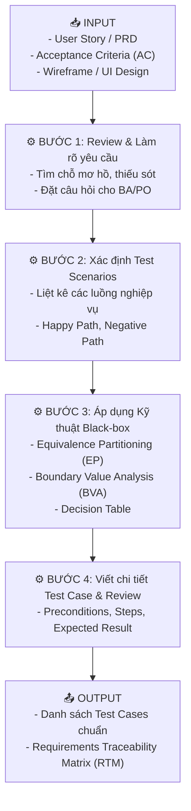
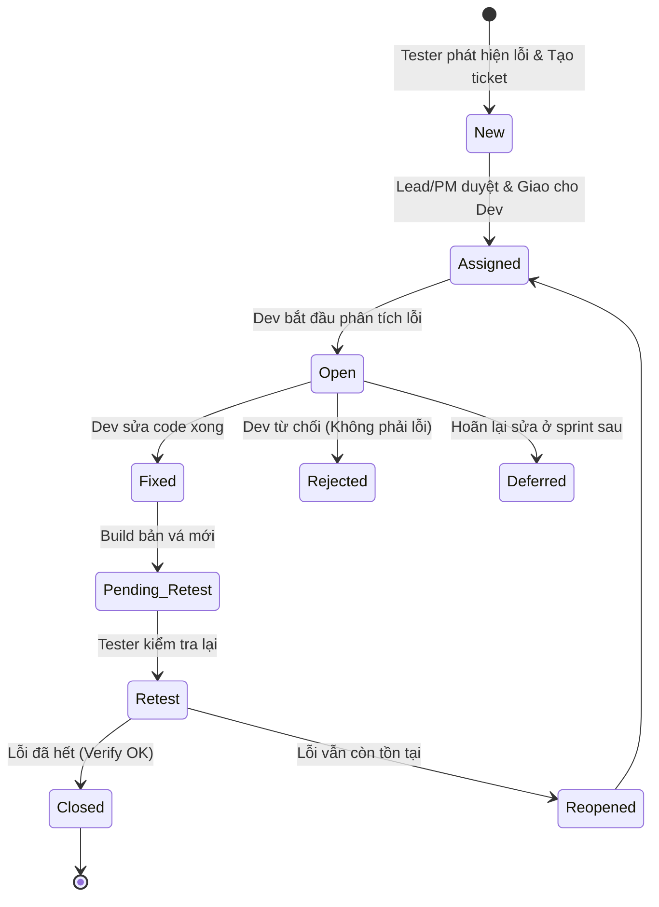

# 📘 CHỦ ĐỀ 01: NỀN TẢNG QA & THIẾT KẾ KIỂM THỬ THỦ CÔNG (QA FOUNDATIONS & MANUAL TESTING)

> **Mã môn tương ứng trong Calendar:** `[L2_AIQE-FPR]` & `[L2_AIQE_MTPTD]`  
> **Mục tiêu:** Giúp Fresher nắm vững nền tảng nguyên lý kiểm thử, các kỹ thuật thiết kế test case chuẩn quốc tế (ISTQB), quy trình quản lý vòng đời lỗi và kỹ năng phân tích kiểm thử thủ công trước khi áp dụng AI.

---

## 📖 1. Từ điển Thuật ngữ Kiểm thử Cốt lõi (Testing Terminology)

Trước khi đi vào quy trình, Fresher cần phân biệt chính xác các thuật ngữ kiểm thử chuẩn ISTQB sau:

| Thuật ngữ (English) | Tên tiếng Việt | Bản chất & Giải thích dễ hiểu | Ví dụ minh họa |
| :--- | :--- | :--- | :--- |
| **QA (Quality Assurance)** | Đảm bảo chất lượng | Tập trung vào **quy trình** (process-oriented) nhằm ngăn ngừa lỗi xuất hiện ngay từ giai đoạn đầu (Prevent defects). Mang tính chủ động (Proactive). | Thiết lập coding standard, quy trình review requirement, quy trình CI/CD. |
| **QC (Quality Control)** | Kiểm soát chất lượng | Tập trung vào **sản phẩm** (product-oriented) nhằm phát hiện và tìm ra lỗi trong phần mềm trước khi release (Find defects). Mang tính phản ứng (Reactive). | Thực thi chạy test case, bấm click kiểm tra chức năng đăng nhập, log bug. |
| **Verification** | Thẩm định / Xác minh | *"Are we building the product right?"* - Kiểm tra xem sản phẩm có được xây dựng đúng theo tài liệu thiết kế và tiêu chuẩn kỹ thuật không (không cần chạy code). | Review tài liệu yêu cầu (SRS), review code logic, walk-through design. |
| **Validation** | Xác thực | *"Are we building the right product?"* - Kiểm tra xem phần mềm có đáp ứng đúng nhu cầu và mong đợi thực tế của người dùng cuối không (thực thi phần mềm). | Chạy thử nghiệm app thực tế, kiểm tra nghiệp vụ thanh toán người dùng. |
| **Error (Mistake)** | Sai lầm của con người | Hành động sai của lập trình viên, BA hoặc tester dẫn đến kết quả sai lệch trong code hoặc tài liệu. | Dev gõ nhầm dấu so sánh `>=` thành `>` trong logic kiểm tra tuổi. |
| **Defect / Bug / Fault** | Khiếm khuyết / Lỗi code | Lỗi nằm ẩn bên trong mã nguồn hoặc tài liệu, xuất phát từ một Error. | Dòng code kiểm tra tuổi chỉ cho phép tuổi > 18 (lỗi ở mốc 18 tuổi). |
| **Failure** | Sự cố / Thất bại vận hành | Khi phần mềm đang chạy gặp hành vi sai lệch so với mong đợi của người dùng (biểu hiện ra bên ngoài). | Khách hàng 18 tuổi bấm Đăng ký thì màn hình báo lỗi "Bạn chưa đủ tuổi". |
| **Test Basis** | Căn cứ kiểm thử | Tất cả tài liệu, kiến thức dùng làm nền tảng để suy ra kịch bản kiểm thử (PRD, User Story, Wireframe, API Spec). | Bản User Story US-01: "Người dùng đăng nhập bằng Email và Password". |
| **Test Oracle** | Nguồn chân lý kiểm thử | Nguồn chuẩn xác để tester đối chiếu xem kết quả thực tế (Actual Result) có đúng hay không. | Quy định pháp luật, tài liệu nghiệp vụ kế toán, hệ thống cũ đang chạy chuẩn. |
| **Severity (Độ nghiêm trọng)** | Mức độ ảnh hưởng kỹ thuật | Mức độ tác động tiêu cực của lỗi lên hệ thống phần mềm (Crash, Mất dữ liệu, Lỗ hổng bảo mật). Phụ thuộc kỹ thuật. | Lỗi crash toàn bộ server khi click nút Help (Severity: Critical). |
| **Priority (Độ ưu tiên)** | Mức độ khẩn cấp xử lý | Mức độ cần thiết phải sửa lỗi càng sớm càng tốt dưới góc độ kinh doanh (Business urgency). | Logo công ty ở trang chủ bị sai màu (Severity: Low, nhưng Priority: High vì đối tác sắp họp báo). |
| **Regression Testing** | Kiểm thử hồi quy | Chạy lại các bài test cũ để đảm bảo tính năng mới thêm vào hoặc việc sửa bug không làm hỏng các tính năng cũ đang chạy tốt. | Sau khi fix lỗi quên mật khẩu, chạy lại toàn bộ flow Đăng nhập và Thanh toán. |
| **Smoke Testing** | Kiểm thử khói (Build verification) | Tập hợp các bài test cơ bản nhất nhằm kiểm tra xem build mới có đủ ổn định để tester tiến hành test chi tiết hay không. | Build mới lên, kiểm tra: Mở được app, Đăng nhập thành công, Trang chủ load được. |
| **Sanity Testing** | Kiểm thử mức độ hợp lý | Tập hợp test nhanh và hẹp tập trung vào một tính năng cụ thể vừa được sửa lỗi để xác nhận bug đã hết. | Sau khi Dev báo đã sửa bug tính sai mã giảm giá 10%, tester kiểm tra nhanh lại việc áp mã này. |
| **RTM (Requirements Traceability Matrix)** | Ma trận truy xuất nguồn gốc | Bảng liên kết 2 chiều giữa Yêu cầu (Requirement) ➔ Test Case ➔ Defect để đảm bảo 100% yêu cầu đều được test. | Bảng mapping: User Story US-01 được bao phủ bởi TC-01, TC-02, TC-03. |

---

## 🔄 2. Bảy Nguyên lý Kiểm thử Cơ bản (7 Testing Principles - ISTQB)

Fresher cần khắc sâu 7 nguyên lý nền tảng để tránh các suy nghĩ phi thực tế trong dự án:
1. **Kiểm thử chỉ ra sự hiện diện của lỗi (Testing shows presence of defects, not absence):** Test chỉ chứng minh phần mềm có lỗi, không thể chứng minh phần mềm 100% không còn lỗi.
2. **Kiểm thử kiệt quệ là bất khả thi (Exhaustive testing is impossible):** Không thể test mọi tổ hợp dữ liệu đầu vào. Phải dùng kỹ thuật phân tích rủi ro và test design để chọn tập mẫu tối ưu.
3. **Kiểm thử càng sớm càng tốt (Early testing):** Tìm ra lỗi ở khâu yêu cầu (Requirement) rẻ hơn gấp hàng chục lần so với tìm thấy lỗi ở môi trường Production.
4. **Sự tập trung của lỗi (Defect clustering):** Đa số các lỗi thường tập trung ở một số ít module phức tạp nhất của hệ thống (Nguyên lý Pareto 80/20).
5. **Nghịch lý thuốc trừ sâu (Pesticide paradox):** Nếu lặp đi lặp lại cùng một bộ test case cũ, dần dần chúng sẽ không phát hiện thêm được lỗi mới nào. Cần liên tục cập nhật test case.
6. **Kiểm thử phụ thuộc ngữ cảnh (Testing is context dependent):** Test trang web thương mại điện tử hoàn toàn khác với test hệ thống y tế hoặc phần mềm máy bay.
7. **Ảo tưởng về sự vắng bóng lỗi (Absence-of-errors fallacy):** Một phần mềm chạy mượt, 0 bug nhưng không đáp ứng đúng nhu cầu người dùng thì vẫn là một sản phẩm thất bại.

---

## ⚙️ 3. Quy trình Kiểm thử theo Mô hình Input - Process - Output

### 📌 Workflow 1: Phân tích Căn cứ Kiểm thử & Thiết kế Test Case (Test Case Design)



#### Chi tiết các thành phần:

#### 1. Dữ liệu Đầu vào (Input):
- **User Story & Acceptance Criteria (AC):** Ví dụ: *“Là nhân viên PortalLite, tôi muốn đăng ký số điện thoại cá nhân (10 chữ số, bắt đầu bằng 03, 05, 07, 08, 09) để nhận mã OTP”*.
- **UI Mockup:** Màn hình nhập số điện thoại, nút “Gửi mã OTP”.
- **Business Rules:** Quy định giới hạn gửi OTP tối đa 3 lần/ngày.

#### 2. Quy trình Xử lý (Process / Workflow):
Áp dụng 3 kỹ thuật Black-box cốt lõi:

* **Kỹ thuật 1: Phân vùng tương đương (Equivalence Partitioning - EP):**
  Chia miền dữ liệu thành các lớp hợp lệ (Valid Partition) và không hợp lệ (Invalid Partition). Mỗi lớp chỉ cần chọn 1 giá trị đại diện để test.
  * *Hợp lệ:* Chuỗi 10 chữ số bắt đầu bằng đầu số hợp lệ (ví dụ: `0912345678`).
  * *Không hợp lệ:* Chứa chữ cái (`09123abcde`), chứa ký tự đặc biệt (`09123@#$12`), ít hơn 10 số (`091234`), nhiều hơn 10 số (`091234567891`).

* **Kỹ thuật 2: Phân tích giá trị biên (Boundary Value Analysis - BVA):**
  Lỗi thường xảy ra ở ranh giới. Với trường hợp độ dài chuỗi $N = 10$:
  * *Kỹ thuật 2 giá trị:* Biên dưới $N-1 = 9$ số; Giá trị đúng $N = 10$ số; Biên trên $N+1 = 11$ số.
  * *Kỹ thuật 3 giá trị:* Kiểm tra $min - 1$, $min$, $min + 1$, $max - 1$, $max$, $max + 1$.

* **Kỹ thuật 3: Bảng quyết định (Decision Table):**
  Dùng khi nghiệp vụ có sự kết hợp của nhiều điều kiện logic phức tạp.
  * *Điều kiện:* (Đúng số ĐT?) AND (Chưa vượt quá 3 lần gửi OTP?)
  * *Hành động:* Gửi OTP hoặc Khóa chức năng tạm thời.

#### 3. Sản phẩm Đầu ra (Output):
Một Test Case chuẩn cần có đầy đủ các cột sau:
* **Test Case ID:** Định danh duy nhất (ví dụ: `TC_REG_PHONE_01`).
* **Test Description / Objective:** Mục tiêu bài test.
* **Precondition:** Điều kiện tiên quyết (ví dụ: Người dùng đang ở màn hình đăng ký).
* **Test Steps:** Các bước thực hiện rõ ràng (Step 1, Step 2...).
* **Test Data:** Dữ liệu cụ thể được dùng.
* **Expected Result:** Kết quả mong đợi (hệ thống phải phản hồi gì).
* **Actual Result:** Kết quả thực tế khi chạy.
* **Status:** Pass / Fail / Blocked.

---

### 📌 Workflow 2: Thực thi Kiểm thử & Quản lý Vòng đời Lỗi (Defect Life Cycle)



#### 1. Dữ liệu Đầu vào (Input):
- Bản dựng phần mềm (Build / Deploy URL).
- Bộ Test Cases cần thực thi.
- Môi trường kiểm thử (Test Environment: OS, Browser, Phiên bản).

#### 2. Quy trình Xử lý (Process / Workflow):
1. **Thực thi:** Làm theo từng bước trong Test Case.
2. **Quan sát & Đối chiếu:** So sánh `Actual Result` với `Expected Result`.
3. **Cách ly & Tái lập (Isolate & Reproduce):** Chạy lại lỗi tối thiểu 2-3 lần để xác nhận bug có tính lặp lại (reproducible). Tìm các bước ngắn nhất dẫn đến lỗi.
4. **Log Bug:** Viết báo cáo lỗi chi tiết theo mẫu chuẩn.
5. **Theo dõi:** Tham gia phiên họp Triage phân loại mức độ Severity/Priority.

#### 3. Sản phẩm Đầu ra (Output) - Cấu trúc Bug Report Chuẩn:
Một Bug Report chuyên nghiệp bao gồm:
```markdown
### [BUG-ID] Title: [Module] Tóm tắt ngắn gọn hành vi lỗi khi thực hiện hành động

- **Severity:** Critical / Major / Minor / Trivial
- **Priority:** High / Medium / Low
- **Environment:** Chrome v128, OS Windows 11, Test Server Staging-02
- **Preconditions:** Tài khoản nhân viên A đã kích hoạt nhưng chưa có quyền Admin.
- **Steps to Reproduce:**
  1. Đăng nhập vào PortalLite với user: `staff_user@company.com`.
  2. Điều hướng tới menu "Quản lý nhân viên".
  3. Bấm nút "Xóa nhân viên" trên dòng nhân viên ID #102.
  4. Xác nhận modal "Đồng ý".
- **Expected Result:** Hệ thống hiển thị thông báo lỗi "403 Forbidden: Bạn không có quyền thực hiện thao tác này".
- **Actual Result:** Hệ thống xóa vĩnh viễn nhân viên #102 khỏi cơ sở dữ liệu và thông báo "Xóa thành công".
- **Evidence / Attachments:** Screenshot `delete_unauthorized.png`, Network log `trace-delete-102.har`.
```

---

## ⚠️ 4. Các Lỗi Phổ biến Fresher hay Mắc phải (Common Pitfalls)

1. **Viết Expected Result mơ hồ:** Ghi *"Hệ thống hoạt động đúng"* hoặc *"Không có lỗi xảy ra"*.  
   👉 *Cách khắc phục:* Phải ghi chính xác hệ thống hiển thị thông báo gì, mã phản hồi HTTP nào, cơ sở dữ liệu thay đổi trường dữ liệu nào.
2. **Nhầm lẫn giữa Severity và Priority:** Cho rằng mọi bug nghiêm trọng đều phải sửa ngay lập tức.  
   👉 *Ví dụ:* Bug crash hệ thống trên Internet Explorer 8 (Severity: High, nhưng Priority: Low vì khách hàng hiện tại 100% dùng Chrome/Edge).
3. **Không ghi rõ Preconditions và Test Data trong Bug Report:** Khiến Dev không thể tái lập được lỗi và đóng ticket với trạng thái *"Cannot Reproduce"*.

---

## 🎯 5. Checklist Ôn tập & Câu hỏi Tự kiểm tra

- [ ] Bạn có thể phân biệt rành rọt giữa **QA** và **QC**, **Verification** và **Validation** không?
- [ ] Bạn có thể giải thích sự khác biệt giữa **Error ➔ Defect ➔ Failure** kèm ví dụ thực tế?
- [ ] Cho một ô nhập "Tuổi của người vay ngân hàng" từ 18 đến 60 tuổi, hãy viết tập test BVA (2 giá trị và 3 giá trị).
- [ ] Trình bày các trạng thái chính trong **Defect Life Cycle** và vai trò của Tester khi bug ở trạng thái `Pending Retest`.

