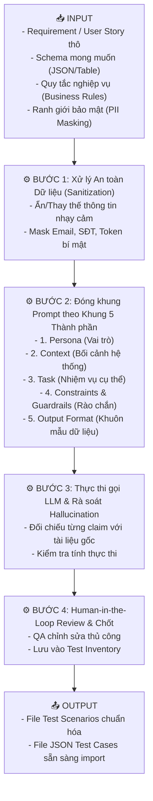

# 📘 CHỦ ĐỀ 02: NỀN TẢNG GENAI & KỸ THUẬT PROMPT ENGINEERING TRONG TESTING

> **Mã môn tương ứng trong Calendar:** `[L2_AIQE_FPE]`  
> **Mục tiêu:** Giúp Fresher hiểu rõ bản chất của Mô hình ngôn ngữ lớn (LLM), làm chủ các kỹ thuật Prompt Engineering nâng cao để ứng dụng vào công việc QA, kiểm soát hiện tượng "ảo giác" (Hallucination), bảo vệ dữ liệu nhạy cảm (PII) và vận hành cơ chế Giám sát của con người (Human-in-the-Loop).

---

## 📖 1. Từ điển Thuật ngữ Cốt lõi (AI & Prompting Terminology)

| Thuật ngữ | Tên tiếng Việt | Bản chất & Giải thích cho Fresher QA | Ví dụ kiểm thử |
| :--- | :--- | :--- | :--- |
| **LLM (Large Language Model)** | Mô hình ngôn ngữ lớn | Mô hình AI được huấn luyện trên lượng dữ liệu văn bản khổng lồ, hoạt động theo cơ chế dự đoán từ/token tiếp theo có xác suất cao nhất. | Gemini, GPT-4, Claude. |
| **Probabilistic vs Deterministic** | Xác suất vs Tất định | **Testing truyền thống** mang tính **tất định** (cùng input ➔ 100% ra đúng cùng output). **LLM** mang tính **xác suất** (cùng prompt có thể sinh ra các câu trả lời khác nhau nếu temperature > 0). | Chạy Playwright test là deterministic; dùng LLM sinh test case là probabilistic. |
| **Prompt** | Câu lệnh / Lời nhắc | Toàn bộ chỉ dẫn văn bản, ngữ cảnh và dữ liệu mà người dùng đưa vào LLM để nhận kết quả mong muốn. | "Đóng vai Senior QA, hãy phân tích đoạn User Story sau..." |
| **Token** | Đơn vị từ tố | Mảnh nhỏ của từ ngữ mà LLM dùng để xử lý (1000 tokens ≈ 750 từ tiếng Anh hoặc khoảng 300-400 từ tiếng Việt). | Mỗi lần gọi API LLM đều bị tính phí dựa trên số lượng Input Tokens và Output Tokens. |
| **Context Window** | Cửa sổ ngữ cảnh | Dung lượng bộ nhớ tối đa mà LLM có thể tiếp nhận và ghi nhớ trong một lần tương tác (tính theo Token). | Nếu ném toàn bộ log 100MB vào LLM có context window nhỏ, model sẽ bị tràn bộ nhớ hoặc quên thông tin đầu. |
| **Hallucination** | Hiện tượng ảo giác | Hiện tượng LLM tự bịa ra thông tin sai lệch, không có thật nhưng trình bày với văn phong cực kỳ tự tin và thuyết phục. | LLM bịa ra một status code HTTP `602` hoặc bịa ra một API endpoint không hề tồn tại trong dự án. |
| **Grounding** | Neo thông tin / Căn cứ sự thật | Kỹ thuật neo câu trả lời của LLM vào một tài liệu nguồn có thật (Source of Truth), yêu cầu LLM chỉ được trả lời dựa trên tài liệu đó. | "Chỉ dùng nội dung trong tài liệu API Spec đính kèm, tuyệt đối không tự suy diễn thêm". |
| **PII (Personally Identifiable Information)** | Thông tin định danh cá nhân | Dữ liệu nhạy cảm của khách hàng thực tế (Họ tên, CCCD/CMND, Số điện thoại, Số thẻ ngân hàng, Mật khẩu). | Cấm gửi dữ liệu PII thật của khách hàng lên LLM công cộng (Vi phạm bảo mật nghiêm trọng). |
| **HITL (Human-in-the-Loop)** | Con người trong vòng lặp | Nguyên tắc bắt buộc kỹ sư QA phải rà soát, kiểm chứng và phê duyệt mọi kết quả do AI sinh ra trước khi đưa vào thực thi. | AI sinh ra 20 test cases, QA review lại thấy 2 case sai nghiệp vụ và loại bỏ trước khi import Jira. |
| **Prompt Drift** | Trôi dạt lời nhắc | Hiện tượng cùng một câu prompt ban đầu chạy tốt, nhưng sau một thời gian khi mô hình AI được nâng cấp ngầm, kết quả sinh ra bị thay đổi hoặc giảm chất lượng. | Cần có bộ test regression đánh giá chất lượng prompt thường xuyên. |

---

## 🧠 2. Các Kỹ thuật Prompt Engineering Thiết yếu cho QA

### 1. Zero-shot Prompting (Hỏi trực tiếp không kèm ví dụ)
Yêu cầu AI thực hiện tác vụ ngay lập tức dựa trên tri thức sẵn có của mô hình.
* *Nhược điểm:* Định dạng đầu ra khó kiểm soát, dễ bị lan man.
* *Ví dụ:* *"Hãy viết 3 test case kiểm tra form đăng nhập."*

### 2. Few-shot Prompting (Học trong ngữ cảnh kèm ví dụ mẫu)
Cung cấp từ 1 đến 3 ví dụ mẫu (cặp Input ➔ Output chuẩn) để định hình phong cách và định dạng mong muốn cho AI.
* *Ưu điểm:* Đầu ra tuân thủ 100% mẫu quy định của dự án.
* *Ví dụ:*
  ```text
  Ví dụ 1:
  Input: "Nút Đăng ký màu xanh, click chuyển trang form"
  Output: "GIVEN người dùng ở trang chủ, WHEN click nút Đăng ký, THEN chuyển hướng sang trang /register"

  Áp dụng cho Input sau:
  Input: "Nút Giỏ hàng hiển thị số lượng badge đỏ, click mở drawer bên phải"
  Output: ?
  ```

### 3. Chain of Thought (CoT - Chuỗi suy luận logic)
Bắt buộc AI phải suy luận từng bước (*"Think step by step"*) trước khi đưa ra kết luận cuối cùng. Rất quan trọng khi phân tích ca kiểm thử logic phức tạp hoặc biên số học.
* *Ví dụ:* *"Trước khi đưa ra test case, hãy phân tích: 1) Các biến đầu vào; 2) Miền giá trị hợp lệ; 3) Các điểm biên; 4) Bảng tổ hợp điều kiện. Sau đó mới sinh test case."*

### 4. Role-based Prompting (Định vị vai trò)
Gán cho AI một danh tính và góc nhìn chuyên môn cụ thể.
* *Ví dụ:* *"Bạn là một Chuyên gia Kiểm thử Bảo mật (Security QA Lead) với 10 năm kinh nghiệm rà soát lỗ hổng OWASP Top 10..."*

### 5. Structured Output Formatting (Định dạng đầu ra có cấu trúc)
Ép AI trả về JSON hoặc Markdown Table để có thể đưa trực tiếp vào script automation hoặc phần mềm quản lý test (Jira/TestRail).

---

## ⚙️ 3. Quy trình Xây dựng Structured Prompt theo Mô hình Input - Process - Output



### 📋 Mẫu Prompt Kỹ thuật Chuẩn cho Fresher (Production-Ready Prompt Template):

```text
[VAI TRÒ - ROLE]
Bạn là Chuyên viên Kiểm thử Đảm bảo Chất lượng (AI Quality Engineer) chuyên sâu về kiểm thử chức năng và phân tích rủi ro phần mềm.

[BỐI CẢNH - CONTEXT]
Hệ thống: Ứng dụng PortalLite - Module Quản lý Tài khoản & Phân quyền Nhân viên.
Tính năng: Khóa tài khoản nhân viên khi nhập sai mật khẩu quá 5 lần liên tiếp.

[TÀI LIỆU CĂN CỨ - TEST BASIS]
- Quy tắc 1: Nếu nhập sai mật khẩu lần thứ 1 đến 4: Hiển thị thông báo "Mật khẩu không đúng. Bạn còn {5 - n} lần thử".
- Quy tắc 2: Nhập sai lần thứ 5: Khóa tài khoản trong 15 phút, gửi email thông báo bảo mật đến hòm thư nhân viên.
- Quy tắc 3: Nếu nhập đúng mật khẩu ở bất kỳ lần nào từ 1 đến 4, bộ đếm số lần sai sẽ được reset về 0.

[RÀO CHẮN & GIỚI HẠN - GUARDRAILS]
1. CHỈ dựa vào 3 quy tắc ở trên. Tuyệt đối không tự suy diễn thêm các quy tắc OTP hay SMS nếu không được đề cập.
2. Nếu phát hiện điểm nào chưa rõ ràng trong quy tắc, hãy tạo riêng một mục "Câu hỏi làm rõ (Clarification Questions)".
3. Mọi ví dụ dữ liệu phải dùng dữ liệu giả lập (Mock data), không dùng dữ liệu người thật.

[NHIỆM VỤ - TASK]
1. Hãy phân tích các phân vùng tương đương (EP) và giá trị biên (BVA) cho biến số lần thử.
2. Liệt kê tối thiểu 4 Test Cases chi tiết bao gồm cả Happy Path và Edge Cases.

[ĐỊNH DẠNG ĐẦU RA - FORMAT]
Trả về bảng Markdown với các cột: ID, Test Description, Precondition, Test Steps, Test Data, Expected Result, Type (Positive/Negative).
```

---

## 🛡️ 4. Quy tắc Bảo mật Dữ liệu & Responsible AI trong Testing

Là một Fresher AIQE, bạn phải tuyệt đối tuân thủ **Thỏa thuận làm việc với AI có trách nhiệm (Responsible AI Working Agreement)**:

1. **Tuyệt đối không đưa PII thật vào Prompt:**
   * ❌ *Sai:* `{"customer_name": "Nguyễn Văn A", "cccd": "001200004567", "credit_card": "4111-2222-3333-4444"}`
   *  *Đúng:* `{"customer_name": "User_Test_01", "cccd": "MASKED_ID_12_DIGITS", "credit_card": "4111-XXXX-XXXX-1111"}`
2. **Không đưa Secrets / API Keys / Password thật vào Prompt:**  
   Mọi credential kết nối database, API token, secret key phải được thay bằng biến môi trường hoặc chuỗi giả lập `MOCK_SECRET_KEY`.
3. **Luôn bật cờ "Human Review":**  
   Mọi tài liệu test case do AI tạo ra đều phải mang nhãn:  
   `[Status: AI-Generated | Reviewed By: <Tên Tester> | Verdict: Approved/Adjusted]`.

---

## ⚠️ 5. Các Lỗi Phổ biến Fresher hay Mắc phải (Common Pitfalls)

1. **Hội chứng "Tin tưởng mù quáng" (Blind Trust):** Copy nguyên văn test case do AI sinh ra dán vào dự án mà không đọc lại, dẫn đến test sai nghiệp vụ hoặc test những tính năng không có thật.
2. **Prompt quá ngắn gọn và chung chung:** Viết *"Viết test case cho tôi"* ➔ AI sẽ trả về kết quả đại trà, không bám sát kiến trúc phần mềm thực tế.
3. **Không đặt ranh giới (Guardrails):** Không ra lệnh cho AI *"Chỉ trả lời dựa trên tài liệu đính kèm"*, khiến AI tự tưởng tượng thêm các chức năng ngoài phạm vi sprint.

---

## 🎯 6. Checklist Ôn tập & Câu hỏi Tự kiểm tra

- [ ] Bạn hiểu thế nào về bản chất **Probabilistic** của LLM so với tính chất **Deterministic** của Testing?
- [ ] Sự khác biệt giữa **Zero-shot**, **Few-shot** và **Chain-of-Thought** prompting là gì? Khi nào nên dùng CoT trong kiểm thử?
- [ ] **Hallucination** là gì? Kể tên 3 kỹ thuật hữu hiệu để ngăn chặn hiện tượng này khi dùng AI viết test case.
- [ ] Dữ liệu PII là gì? Nếu bạn cần dùng AI để phân tích file log chứa 1000 giao dịch thẻ tín dụng khách hàng, bạn phải xử lý file log đó như thế nào trước khi gửi cho LLM?

