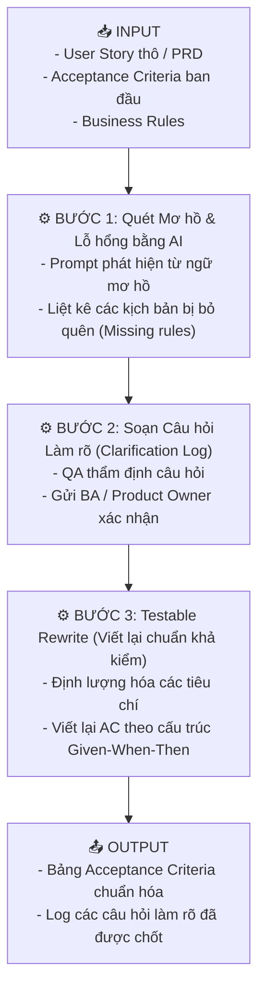
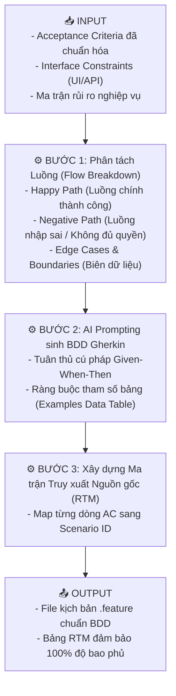
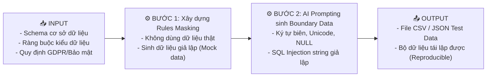

# 📘 CHỦ ĐỀ 03: PHÂN TÍCH YÊU CẦU & THIẾT KẾ KIỂM THỬ CÓ AI HỖ TRỢ (ARTD)

> **Mã môn tương ứng trong Calendar:** `[L3_AIQE_ARTD]` (AI-Assisted Requirement & Test Design)  
> **Mục tiêu:** Giúp Fresher AIQE làm chủ kỹ năng ứng dụng AI để phân tích tính khả kiểm của yêu cầu (Testability), phát hiện các điểm mơ hồ (Ambiguity), phân tích lỗ hổng bao phủ (Coverage gaps), sinh kịch bản kiểm thử BDD Gherkin chuẩn chỉ, lập ma trận truy xuất nguồn gốc (RTM) và tạo dữ liệu kiểm thử an toàn (Privacy-safe Test Data).

---

## 📖 1. Từ điển Thuật ngữ Kiểm thử Cốt lõi trong ARTD

| Thuật ngữ | Tên tiếng Việt | Bản chất & Ý nghĩa đối với Fresher QA | Ví dụ trực quan |
| :--- | :--- | :--- | :--- |
| **Requirement Testability** | Tính khả kiểm của yêu cầu | Mức độ mà một yêu cầu được viết rõ ràng, định lượng được, sao cho tester có thể thiết kế bài test xác định được kết quả Pass hoặc Fail một cách khách quan. | ❌ *"Hệ thống phải phản hồi nhanh"* (Không khả kiểm).<br> *"Thời gian phản hồi API phải dưới 500ms khi có 100 người dùng đồng thời"* (Khả kiểm). |
| **Ambiguity Detection** | Phát hiện sự mơ hồ | Kỹ thuật tìm ra các từ ngữ đa nghĩa, không rõ ràng, có thể bị Dev và Tester hiểu theo hai cách khác nhau trong tài liệu SRS/User Story. | Các từ ngữ cảnh báo mơ hồ: *"nhanh chóng", "thân thiện", "đầy đủ", "phù hợp", "v.v.", "nếu cần thiết"*. |
| **Contradiction** | Mâu thuẫn logic | Hai hoặc nhiều quy định trong tài liệu yêu cầu xung đột, phủ định lẫn nhau. | Trang A ghi *"Chỉ cho phép mật khẩu 8-16 ký tự"*, nhưng Trang B ghi *"Mật khẩu tối thiểu 6 ký tự"*. |
| **BDD (Behavior-Driven Development)** | Phát triển hướng hành vi | Phương pháp phát triển phần mềm mà nghiệp vụ và kiểm thử được mô tả thông qua hành vi cụ thể của hệ thống dưới góc nhìn người dùng bằng ngôn ngữ tự nhiên có cấu trúc. | Viết test theo định dạng dễ hiểu chung cho cả BA, Developer, Tester và Khách hàng. |
| **Gherkin Syntax** | Cú pháp Gherkin | Cú pháp chuẩn của BDD sử dụng bộ từ khóa: **Given** (Tiền đề/Trạng thái ban đầu), **When** (Hành động kích hoạt), **Then** (Kết quả mong đợi quan sát được), **And / But** (Bổ sung điều kiện). | `GIVEN user logged in`<br>`WHEN click Logout`<br>`THEN redirect to /login`. |
| **Coverage Gap** | Lỗ hổng độ bao phủ | Những luồng nghiệp vụ, trường hợp ngoại lệ hoặc giá trị biên mà tài liệu yêu cầu quên không nhắc đến hoặc bộ test case hiện tại chưa kiểm tra tới. | Quên không quy định: *"Người dùng đang thanh toán mà mất mạng Internet giữa chừng thì giao dịch tính thế nào?"* |
| **RTM (Requirements Traceability Matrix)** | Ma trận truy vết yêu cầu | Bảng đối chiếu đảm bảo mỗi tiêu chí chấp nhận (Acceptance Criteria - AC) đều có ít nhất một Test Case bao phủ và ngược lại. | Mapping: `AC-01 ➔ TC-01 (Happy Path), TC-02 (Negative)`. |
| **Exploratory Testing Charter** | Hiến chương kiểm thử khám phá | Một tài liệu ngắn gọn xác định mục tiêu, phạm vi, thời gian (Timebox) và góc nhìn kiểm thử để tester tự do khám phá tìm lỗi mà không cần kịch bản cố định từng bước (dựa trên phương pháp SBTM). | *"Khám phá tính năng lọc danh sách nhân viên trong 45 phút dưới góc nhìn người dùng nhập ký tự đặc biệt"*. |
| **Synthetic Test Data** | Dữ liệu kiểm thử nhân tạo | Dữ liệu được sinh tự động bằng thuật toán hoặc AI, có cấu trúc giống hệt dữ liệu thật nhưng không chứa thông tin của bất kỳ cá nhân ngoài đời nào. | Tạo 1000 hồ sơ nhân viên ảo với tên như `User_A1`, email `test_a1@mockcorp.internal`. |

---

## ⚙️ 2. Các Quy trình Trọng tâm theo Mô hình Input - Process - Output

---

### 📌 Workflow 1: Phân tích Yêu cầu, Phát hiện Mơ hồ & Viết lại Khả kiểm (Unit 1 ARTD)



#### 1. Dữ liệu Đầu vào (Input):
Đoạn User Story thô nhận từ Business Analyst (BA):
> *"Là Quản lý nhân sự, tôi muốn hệ thống cập nhật trạng thái nhân viên nhanh chóng và gửi thông báo phù hợp khi nhân viên thôi việc."*

#### 2. Quy trình Xử lý (Process / Workflow):
* **Bước 1 (AI Prompting phát hiện lỗi):** Sử dụng AI để rà soát:
  * Từ mơ hồ: *"nhanh chóng"* (Bao nhiêu mili-giây?), *"phù hợp"* (Thông báo qua Email, SMS hay In-app Notification? Nội dung thông báo gồm những gì?).
  * Thiếu sót (Missing rule): Ai có quyền thực hiện thao tác này? Nhân viên bị chuyển sang trạng thái "Thôi việc" thì các phiên đăng nhập hiện tại trên thiết bị di động có bị hủy bỏ ngay lập tức không?
* **Bước 2 (Clarification Log):** QA tổng hợp câu hỏi gửi Product Owner.
* **Bước 3 (Testable Rewrite):** Viết lại AC có thể kiểm thử định lượng.

#### 3. Sản phẩm Đầu ra (Output):
Bản Acceptance Criteria viết lại (Testable Rewrite):
```markdown
### User Story: Cập nhật trạng thái thôi việc của nhân viên
- **AC-01 (Phân quyền):** Chỉ người dùng có vai trò `HR_MANAGER` mới có quyền đổi trạng thái nhân viên thành `TERMINATED`.
- **AC-02 (Thời gian xử lý):** Hệ thống phải cập nhật trạng thái trong cơ sở dữ liệu trong vòng dưới 1000ms.
- **AC-03 (Hủy phiên):** Ngay khi trạng thái chuyển sang `TERMINATED`, tất cả JWT Access Token hiện tại của nhân viên đó phải bị vô hiệu hóa trong vòng 5 giây.
- **AC-04 (Thông báo):** Hệ thống gửi email tự động theo mẫu `TMPL_RESIGNATION` đến email cá nhân của nhân viên trong vòng 60 giây.
```

---

### 📌 Workflow 2: Sinh Kịch bản Kiểm thử BDD Gherkin & Ma trận RTM (Unit 3 & 4 ARTD)



#### 1. Dữ liệu Đầu vào (Input):
- Tiêu chí AC-01 và AC-03 từ Workflow 1.
- Danh sách tài khoản thử nghiệm trên môi trường Staging.

#### 2. Quy trình Xử lý (Process / Workflow):
Prompt cho AI sinh kịch bản BDD theo mẫu chuẩn:
```text
Dựa vào tiêu chí AC-01 và AC-03, hãy tạo 2 kịch bản BDD Gherkin:
- Kịch bản 1: Người dùng có vai trò HR_MANAGER thôi việc nhân viên thành công (Happy Path).
- Kịch bản 2: Người dùng có vai trò STAFF cố gắng thao tác thôi việc nhân viên (Negative Path).
Yêu cầu: Bước Given phải nêu rõ trạng thái đăng nhập, When nêu rõ hành động click/gửi request, Then nêu rõ kết quả giao diện và mã lỗi.
```

#### 3. Sản phẩm Đầu ra (Output):
File `employee_termination.feature`:
```gherkin
Feature: Chấm dứt hợp đồng và thôi việc nhân viên trong PortalLite

  Scenario: HR Manager cập nhật trạng thái thôi việc nhân viên thành công
    Given Người dùng đã đăng nhập với vai trò "HR_MANAGER"
    And Nhân viên có mã "EMP-102" đang có trạng thái "ACTIVE"
    When Quản lý truy cập trang hồ sơ nhân viên "EMP-102"
    And Chọn trạng thái "TERMINATED" và bấm "Xác nhận cập nhật"
    Then Hệ thống hiển thị thông báo thành công "Cập nhật trạng thái thành công"
    And Trạng thái nhân viên "EMP-102" hiển thị là "TERMINATED"
    And Mọi phiên đăng nhập hiện tại của "EMP-102" bị chấm dứt

  Scenario: Nhân viên thông thường không được phép cập nhật trạng thái thôi việc
    Given Người dùng đã đăng nhập với vai trò "STAFF"
    When Người dùng gửi yêu cầu cập nhật trạng thái nhân viên "EMP-102" thành "TERMINATED"
    Then Hệ thống từ chối yêu cầu với mã phản hồi "403 Forbidden"
    And Trạng thái nhân viên "EMP-102" vẫn giữ nguyên là "ACTIVE"
```

Bảng Ma trận Truy xuất Nguồn gốc (RTM):
| Requirement ID | Acceptance Criteria | Test Scenario ID | Loại Kiểm thử | Trạng thái Bao phủ |
| :--- | :--- | :--- | :--- | :--- |
| **REQ-HR-01** | AC-01 (Quyền HR_MANAGER) | `SC_TERM_01` (Positive), `SC_TERM_02` (Negative) | Phân quyền & Chức năng | ✅ 100% Covered |
| **REQ-HR-01** | AC-03 (Thu hồi Token) | `SC_TERM_01` | Bảo mật & Session | ✅ 100% Covered |

---

### 📌 Workflow 3: Sinh Dữ liệu Kiểm thử Độc lập & An toàn Bảo mật (Unit 6 ARTD)



#### Ví dụ Bộ Dữ liệu Biên (Boundary Test Data Table):
| Field Name | Loại Test | Giá trị Test Data | Mục đích Kiểm thử |
| :--- | :--- | :--- | :--- |
| `phone_number` | Min - 1 (Thiếu số) | `091234567` (9 số) | Kiểm tra bắt lỗi validate form frontend |
| `phone_number` | Exact Valid (Đúng biên) | `0912345678` (10 số) | Kiểm tra lưu thông tin hợp lệ |
| `phone_number` | Max + 1 (Thừa số) | `09123456789` (11 số) | Kiểm tra chặn không cho nhập tiếp |
| `employee_name` | Ký tự Unicode đặc biệt | `Nguyễn Văn Đỗ @#$%^` | Kiểm tra encode UTF-8 và chống XSS |
| `employee_name` | Chuỗi siêu dài | Chuỗi 256 ký tự 'A' | Kiểm tra tràn bộ đệm hoặc cắt ngắn chuỗi |

---

## ⚠️ 3. Các Lỗi Phổ biến Fresher hay Mắc phải (Common Pitfalls)

1. **Viết kịch bản BDD theo thao tác kỹ thuật UI chi tiết thay vì hành vi nghiệp vụ:**  
   ❌ *Sai:* `When tôi nhập chuột vào tọa độ X:120 Y:300 và gõ phím 'abc'`  
   *Đúng:* `When người dùng nhập tên đăng nhập "abc"`  
   *(BDD tập trung vào **hành vi**, không gắn chặt với vị trí pixel trên màn hình).*
2. **Bỏ quên kiểm thử tác động thay đổi (Change Impact Analysis):**  
   Khi khách hàng đổi yêu cầu, chỉ sửa test case của tính năng đó mà không dùng AI rà soát xem các module liên quan nào khác bị ảnh hưởng.
3. **Sinh dữ liệu kiểm thử trùng lặp:** Sinh hàng chục test case nhưng dữ liệu cùng thuộc một lớp tương đương (Valid Partition), gây lãng phí thời gian chạy test mà không tăng độ bao phủ lỗi.

---

## 🎯 4. Checklist Ôn tập & Câu hỏi Tự kiểm tra

- [ ] Thế nào là một yêu cầu phần mềm "Khả kiểm" (Testable Requirement)? Hãy chỉ ra 3 dấu hiệu của một yêu cầu kém khả kiểm.
- [ ] Phân biệt **Given**, **When**, **Then** trong cú pháp BDD Gherkin.
- [ ] Tại sao trong dự án Agile cần xây dựng **Requirements Traceability Matrix (RTM)**?
- [ ] Hãy trình bày một cấu trúc **Exploratory Testing Charter** chuẩn theo phương pháp SBTM.

