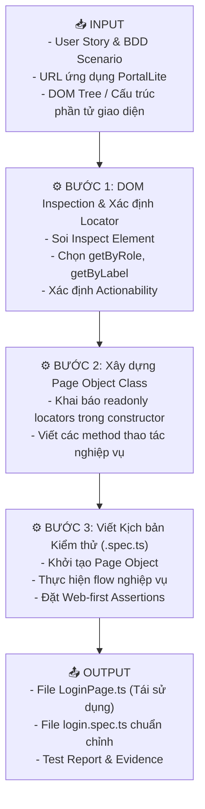
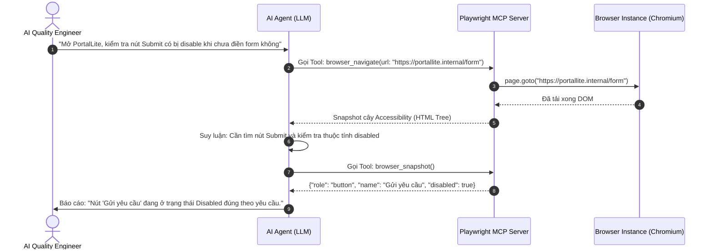
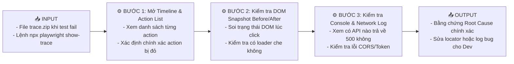

# 📘 CHỦ ĐỀ 04: TỰ ĐỘNG HÓA VỚI PLAYWRIGHT & CHIẾN LƯỢC LOCATOR / MCP (PMLM)

> **Mã môn tương ứng trong Calendar:** `[L3_AIQE_PMLM]` (Playwright MCP & Locator Mastery)  
> **Mục tiêu:** Giúp Fresher AIQE làm chủ kiến trúc Playwright, cơ chế cách ly BrowserContext, kỹ thuật tự động chờ (Auto-waiting), chiến lược viết Locator bền vững theo chuẩn trợ năng (Accessible Roles), mô hình Page Object Model (POM), giao thức kết nối Model Context Protocol (MCP) và kỹ năng điều tra lỗi tự động hóa bằng Trace Viewer.

---

## 📖 1. Từ điển Thuật ngữ Cốt lõi trong PMLM

| Thuật ngữ | Tên tiếng Việt | Bản chất & Giải thích kỹ thuật | Ví dụ mã lệnh / Thực tế |
| :--- | :--- | :--- | :--- |
| **Browser Isolation** | Cách ly trình duyệt | Mỗi phiên test trong Playwright chạy trong một **BrowserContext** hoàn toàn sạch sẽ, độc lập, không dùng chung cookies, cache hay localStorage với các test khác (tương đương mở một cửa sổ ẩn danh Incognito mới). | `const context = await browser.newContext();`<br>Đảm bảo test case 2 không bị ảnh hưởng bởi phiên đăng nhập của test case 1. |
| **Locator** | Bộ định vị phần tử | Đối tượng đại diện cho một phần tử giao diện trên DOM, có khả năng tìm kiếm lại phần tử tại thời điểm thực hiện thao tác (Lazy evaluation). | `page.getByRole('button', { name: 'Đăng nhập' })` |
| **Accessible Role** | Vai trò trợ năng | Khái niệm của chuẩn HTML accessibility (W3C ARIA), xác định chức năng ngữ nghĩa của phần tử đối với người dùng (ví dụ: `button`, `heading`, `textbox`, `combobox`, `dialog`). | Người dùng nhìn vào thấy một nút bấm thì Playwright định vị bằng `getByRole('button')`. |
| **Auto-waiting** | Cơ chế tự động chờ | Playwright tự động chờ đợi phần tử thỏa mãn các điều kiện hành động (Actionability checks) trước khi click hoặc gõ phím, loại bỏ hoàn toàn nhu cầu dùng lệnh ngủ cứng `sleep()`. | Khi gọi `locator.click()`, Playwright tự động chờ đến khi nút xuất hiện, hiển thị, không bị che khuất và dừng chuyển động animation. |
| **Actionability Checks** | Kiểm tra tính khả thi hành động | Danh sách kiểm tra ngầm định trước khi thực hiện thao tác: Phần tử phải **Attached** (gắn vào DOM), **Visible** (hiển thị), **Stable** (không chuyển động), **Enabled** (không bị disable), **Receiving Events** (không bị che bởi modal hay loader). | Tránh lỗi kinh điển `ElementNotInteractableException` trong Selenium. |
| **Web-first Assertions** | Khẳng định web bất đồng bộ | Lệnh kiểm tra (`expect`) có cơ chế tự động thử lại (polling/retry) cho đến khi điều kiện mong muốn được đáp ứng hoặc hết thời gian timeout. | `await expect(page.locator('.status')).toHaveText('Success');` (Tự động retry trong 5s cho đến khi chữ 'Success' xuất hiện). |
| **Page Object Model (POM)** | Mô hình đối tượng trang | Mẫu thiết kế phần mềm (Design Pattern) tách biệt giữa **Giao diện trang** (chứa locator và các hàm thao tác UI) và **Kịch bản kiểm thử** (chứa flow kiểm thử và assertion). | File `LoginPage.ts` chứa hàm `login()`, file `login.spec.ts` chỉ gọi hàm và assert. |
| **Headless vs Headed** | Không giao diện vs Có giao diện | **Headed:** Trình duyệt bật lên cửa sổ trực quan để tester nhìn thấy. **Headless:** Trình duyệt chạy ngầm trong bộ nhớ, không tốn tài nguyên hiển thị (dùng khi chạy tự động trên CI/CD server). | Chạy máy cá nhân: `headed`; Chạy GitHub Actions: `headless`. |
| **MCP (Model Context Protocol)** | Giao thức ngữ cảnh mô hình | Giao thức mở cho phép AI Agent (như Claude, Antigravity) giao tiếp và điều khiển trực tiếp các công cụ kiểm thử như Playwright thông qua tập lệnh tiêu chuẩn (Tools). | Agent gọi tool `browser_click` hoặc `browser_navigate` để tự thao tác trên web. |
| **Trace Viewer** | Trình xem vết thực thi | Công cụ cứu cánh số 1 của Playwright, ghi lại toàn bộ video, timeline, DOM snapshot, console log và network request của từng bước test trong file nén `.zip`. | Mở file `trace.zip` để tua lại xem tại sao test case bị fail ở giây thứ 14. |
| **Flakiness (Flaky test)** | Kiểm thử không ổn định | Một bài test lúc thì Pass, lúc thì Fail mà mã nguồn phần mềm không hề có bất kỳ thay đổi nào (thường do lỗi mạng chậm, animation chưa xong hoặc locator không bền). | Bài test bị fail vào ban đêm trên CI vì server mạng giật khiến modal popup load trễ 200ms. |

---

## 🎯 2. Tiêu chí của một Locator Bền vững (Locator Contract)

Playwright khuyến nghị thứ tự ưu tiên lựa chọn locator từ **tốt nhất** đến **kém nhất**:

```
[MỨC 1: ƯU TIÊN CAO NHẤT] ➔ Dựa trên Trợ năng & Hành vi người dùng (User-facing)
  ├── page.getByRole('button', { name: 'Submit' })   <-- Tốt nhất, bám theo cách người dùng nhận diện
  ├── page.getByLabel('Tên đăng nhập')              <-- Dùng cho form input gắn với <label>
  ├── page.getByPlaceholder('Nhập email của bạn')   <-- Dùng cho input có placeholder
  └── page.getByText('Đăng ký thành công')          <-- Dùng để assert dòng text thông báo

[MỨC 2: ƯU TIÊN TRUNG BÌNH] ➔ Thuộc tính kiểm thử chuyên dụng (Test Attributes)
  └── page.getByTestId('submit-order-btn')          <-- Dùng data-testid khi UI không có role rõ ràng

[MỨC 3: ANTI-PATTERNS - TRÁNH DÙNG] ➔ Dễ vỡ khi giao diện thay đổi
  ├── page.locator('div > div:nth-child(2) > button') <-- Tuyệt đối tránh: XPath/CSS cấu trúc tuyệt đối
  └── page.locator('.btn-primary-sc-1a2b3c')          <-- Tránh: Class CSS sinh tự động từ React/Tailwind
```

---

## ⚙️ 3. Các Quy trình Thực thi Chuẩn theo Mô hình Input - Process - Output

---

### 📌 Workflow 1: Xây dựng Kịch bản Test Tự động theo Mô hình Page Object Model (POM)



#### Mã nguồn Minh họa (PortalLite Case Study):

**1. File Page Object (`tests/pages/LoginPage.ts`):**
```typescript
import { Page, Locator, expect } from '@playwright/test';

export class LoginPage {
  readonly page: Page;
  readonly usernameInput: Locator;
  readonly passwordInput: Locator;
  readonly loginButton: Locator;
  readonly errorMessage: Locator;

  constructor(page: Page) {
    this.page = page;
    // Sử dụng chiến lược Locator chuẩn Accessibility
    this.usernameInput = page.getByLabel('Tên đăng nhập');
    this.passwordInput = page.getByLabel('Mật khẩu');
    this.loginButton = page.getByRole('button', { name: 'Đăng nhập' });
    this.errorMessage = page.getByRole('alert');
  }

  async goto() {
    await this.page.goto('/login');
  }

  async login(username: string, pass: string) {
    await this.usernameInput.fill(username);
    await this.passwordInput.fill(pass);
    await this.loginButton.click();
  }

  async assertErrorMessage(expectedText: string) {
    // Web-first assertion: tự động retry chờ thông báo xuất hiện
    await expect(this.errorMessage).toBeVisible({ timeout: 5000 });
    await expect(this.errorMessage).toContainText(expectedText);
  }
}
```

**2. File Kịch bản Kiểm thử (`tests/specs/login.spec.ts`):**
```typescript
import { test, expect } from '@playwright/test';
import { LoginPage } from '../pages/LoginPage';

test.describe('PortalLite - Xác thực tài khoản người dùng', () => {
  let loginPage: LoginPage;

  test.beforeEach(async ({ page }) => {
    loginPage = new LoginPage(page);
    await loginPage.goto();
  });

  test('TC-LOGIN-01: Đăng nhập thành công với tài khoản Quản trị viên', async ({ page }) => {
    await loginPage.login('admin@portallite.com', 'AdminPass@123');
    
    // Khẳng định đã chuyển hướng sang Dashboard
    await expect(page).toHaveURL(/.*dashboard/);
    await expect(page.getByRole('heading', { name: 'Bảng điều khiển quản trị' })).toBeVisible();
  });

  test('TC-LOGIN-02: Báo lỗi chính xác khi nhập sai mật khẩu', async () => {
    await loginPage.login('admin@portallite.com', 'WrongPassword');
    await loginPage.assertErrorMessage('Thông tin đăng nhập không chính xác');
  });
});
```

---

### 📌 Workflow 2: Tương tác Live Execution thông qua Playwright MCP Server

Trong kỷ nguyên AIQE, AI Agent tương tác với trình duyệt thông qua **Model Context Protocol (MCP)**:



#### 1. Dữ liệu Đầu vào (Input):
- Server MCP được khởi động (file cấu hình `mcp.json`).
- Quyền truy cập sandbox và trình duyệt mục tiêu.

#### 2. Quy trình Xử lý (Process / Workflow):
1. Agent gửi lệnh qua JSON-RPC đến MCP Server.
2. MCP Server dịch lệnh thành API Playwright tương ứng (`page.click`, `page.fill`, `page.screenshot`).
3. Trình duyệt phản hồi trạng thái thực tế kèm ảnh chụp màn hình (Snapshot).
4. Agent đối chiếu kết quả với mục tiêu ban đầu.

---

### 📌 Workflow 3: Điều tra Lỗi Kiểm thử với Playwright Trace Viewer



---

## ⚠️ 4. Các Lỗi Phổ biến Fresher hay Mắc phải (Common Pitfalls)

1. **Dùng lệnh `page.waitForTimeout(5000)` (Hardcoded Sleep):**  
   Đây là điều tối kỵ trong Playwright. Lệnh ngủ tĩnh khiến test chạy chậm chạp và vẫn có thể fail nếu server lag hơn 5s.  
   👉 *Giải pháp:* Luôn dùng Web-first assertions như `await expect(locator).toBeVisible()` hoặc `page.waitForResponse()`.
2. **Quên từ khóa `await`:**  
   Playwright là thư viện 100% bất đồng bộ (Asynchronous). Quên `await` trước các hàm `page.click()` hay `expect()` sẽ khiến test nhảy cóc qua bước tiếp theo và văng lỗi khó hiểu.
3. **Sử dụng XPath phụ thuộc vào vị trí cha con tuyệt đối:**  
   `xpath=/html/body/div[2]/div/div[3]/button` sẽ chết ngay khi Dev chỉ cần bọc thêm 1 thẻ `<div>` để căn lề.

---

## 🎯 5. Checklist Ôn tập & Câu hỏi Tự kiểm tra

- [ ] Phân biệt cơ chế **Browser** và **BrowserContext** trong Playwright. Tại sao BrowserContext lại giúp test chạy nhanh và cô lập?
- [ ] Kể tên 4 thuộc tính mà Playwright tự động kiểm tra trong **Actionability checks** trước khi click một button.
- [ ] Tại sao `page.getByRole('button', { name: 'Lưu' })` lại tốt hơn `page.locator('.btn-save')`?
- [ ] Nêu vai trò của **Model Context Protocol (MCP)** khi kết hợp giữa Playwright và AI Agent.
- [ ] Làm thế nào để cấu hình Playwright luôn ghi lại trace mỗi khi có bài test bị thất bại (`trace: 'retain-on-failure'`)?

