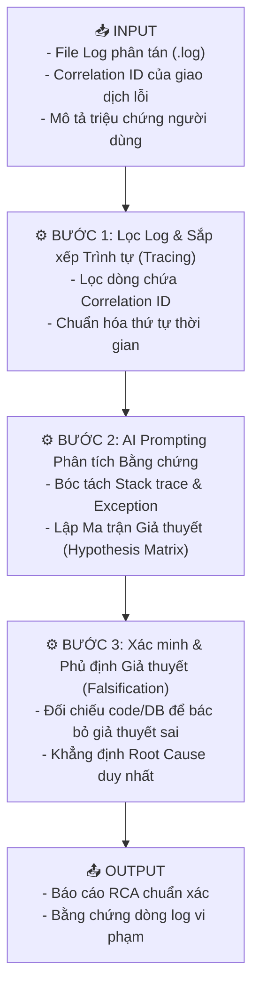
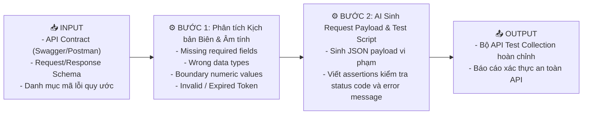

# 📘 CHỦ ĐỀ 05: PHÂN TÍCH LỖI, API & LOG CÓ HỖ TRỢ AI (DALA)

> **Mã môn tương ứng trong Calendar:** `[L3_AIQE_ADALA]` / `[L3_AIQE_DALA]`  
> **Mục tiêu:** Giúp Fresher AIQE thành thạo kỹ năng bóc tách log phân tán (Distributed Logs), truy vết giao dịch bằng Correlation ID, thiết kế kiểm thử API âm tính (Negative API Testing), vận dụng AI để phân tích nguyên nhân gốc (RCA - Root Cause Analysis) trong ranh giới bằng chứng nghiêm ngặt và lập báo cáo lỗi đạt chuẩn Bug Triage.

---

## 📖 1. Từ điển Thuật ngữ Cốt lõi trong DALA

| Thuật ngữ | Tên tiếng Việt | Bản chất & Giải thích kỹ thuật | Ví dụ kiểm thử |
| :--- | :--- | :--- | :--- |
| **Symptom vs Root Cause** | Triệu chứng vs Nguyên nhân gốc | **Triệu chứng:** Biểu hiện sai lệch mà người dùng nhìn thấy bên ngoài. **Nguyên nhân gốc:** Lỗi logic cốt lõi sâu trong code/DB sinh ra triệu chứng đó. | Triệu chứng: *"Nút thanh toán xoay tròn hoài"*. Nguyên nhân gốc: *"Deadlock trong DB bảng `inventory` khiến lock timeout 30s"*. |
| **Correlation ID (Request ID)** | Mã định danh tương quan | Một chuỗi UUID duy nhất được gắn vào Request Header ngay từ cổng vào (API Gateway) và được truyền qua toàn bộ các microservices để xâu chuỗi một luồng xử lý. | `X-Correlation-ID: a9b8c7d6-1234-5678-90ab-cdef12345678` xuất hiện xuyên suốt từ Web ➔ Order Service ➔ Payment Gateway ➔ Database. |
| **Distributed Tracing** | Truy vết phân tán | Khả năng theo dõi một yêu cầu khi nó đi qua hàng chục microservices khác nhau trong kiến trúc đám mây hiện đại. | Dùng Correlation ID để lọc ra toàn bộ log của 1 giao dịch bị lỗi giữa 5 triệu dòng log mỗi ngày. |
| **Evidence Boundary** | Ranh giới bằng chứng | Nguyên tắc kỷ luật bắt buộc: Tester/AI chỉ được đưa ra kết luận nếu có bằng chứng log/mã lỗi chứng minh; không được biến phỏng đoán thành sự thật. | ❌ *"Server bị hack"* (Suy diễn không căn cứ).<br> *"Log dòng 42 ghi `ConnectionTimeout to Redis:6379` nên cache không khả dụng"* (Có bằng chứng). |
| **Idempotency** | Tính lũy thừa / Tính bất biến | Thuộc tính của một API khi gọi 1 lần hay gọi 10 lần liên tiếp với cùng dữ liệu thì kết quả trên server vẫn không thay đổi và tài nguyên không bị tạo thừa. | Phương thức `GET`, `PUT`, `DELETE` bắt buộc phải idempotent. `POST` thông thường không idempotent (nếu click 2 lần có thể bị trừ tiền 2 lần). |
| **JSON Schema Validation** | Thẩm định lược đồ JSON | Kiểm tra cấu trúc dữ liệu phản hồi từ API có đúng với bản hợp đồng quy định không (kiểu dữ liệu, các trường bắt buộc, giá trị min/max). | API trả về `"age": "twenty"` là vi phạm schema (yêu cầu `"type": "integer"`). |
| **Defect Triage** | Phân loại & Sàng lọc lỗi | Buổi họp giữa QA Lead, Dev Lead và Product Owner để xem xét các lỗi mới log, đánh giá Severity/Priority và quyết định: Sửa ngay, Hoãn lại hay Từ chối. | Bug lỗi thanh toán thẻ Visa được gán Priority P1 (sửa trong ngày). |
| **Timestamp Skew** | Lệch đồng hồ thời gian | Hiện tượng đồng hồ giữa các server khác nhau bị lệch vài giây/mili-giây, khiến thứ tự dòng log bị đảo lộn khi gom về một chỗ. | Cần dựa vào Correlation ID và sequence number thay vì chỉ nhìn vào cột thời gian để xếp thứ tự sự kiện. |

---

## 🌐 2. Nền tảng Kiểm thử Hợp đồng API (API Testing Contract)

Fresher cần nắm chắc ý nghĩa của các nhóm HTTP Status Code:
* **2xx (Thành công):** `200 OK` (Thành công chuẩn), `201 Created` (Tạo mới tài nguyên thành công sau POST), `204 No Content` (Xóa thành công, không có body trả về).
* **4xx (Lỗi phía Client):** `400 Bad Request` (Dữ liệu gửi lên sai cú pháp/schema), `401 Unauthorized` (Chưa đăng nhập / Token thiếu hoặc hết hạn), `403 Forbidden` (Đã đăng nhập nhưng không đủ quyền), `404 Not Found` (URL hoặc ID không tồn tại), `409 Conflict` (Xung đột dữ liệu, ví dụ email đã được đăng ký).
* **5xx (Lỗi phía Server):** `500 Internal Server Error` (Code backend bị văng unhandled exception), `502 Bad Gateway` (Server trung gian lỗi), `503 Service Unavailable` (Server quá tải hoặc đang bảo trì), `504 Gateway Timeout` (Chờ microservice phía sau quá lâu).

---

## ⚙️ 3. Các Quy trình Thực thi Chuẩn theo Mô hình Input - Process - Output

---

### 📌 Workflow 1: Phân tích Log Đa tầng & Xác định Nguyên nhân Gốc (RCA) với AI



#### 1. Dữ liệu Đầu vào (Input) - Đoạn trích Log Thực tế (Case Study: Duplicate Charge):
```log
2026-10-14T07:15:01.102Z [API-GATEWAY] INFO  req_id=corr-7788 POST /orders - User: usr_44
2026-10-14T07:15:01.250Z [ORDER-SVC]   INFO  req_id=corr-7788 Creating pending order #ORD-991
2026-10-14T07:15:01.300Z [PAYMENT-SVC] INFO  req_id=corr-7788 Invoking Bank Gateway for $150
2026-10-14T07:15:06.305Z [PAYMENT-SVC] ERROR req_id=corr-7788 SocketTimeoutException after 5000ms
2026-10-14T07:15:06.310Z [ORDER-SVC]   WARN  req_id=corr-7788 Payment failed or timeout. Retrying payment attempt 2...
2026-10-14T07:15:06.400Z [PAYMENT-SVC] INFO  req_id=corr-7788 Invoking Bank Gateway for $150 (Attempt 2)
2026-10-14T07:15:07.100Z [PAYMENT-SVC] INFO  req_id=corr-7788 Charge SUCCESS on Attempt 2! Ref: BANK-TX-882
```
*Ghi chú tài khoản ngân hàng khách hàng:* Bị trừ tiền **2 lần** (\$150 x 2 = \$300).

#### 2. Quy trình Xử lý (Process / Workflow):
Prompting AI rà soát lỗi theo khung **Evidence Boundary**:
> *"Dựa vào đoạn log trên, hãy xác định nguyên nhân tại sao khách hàng bị trừ tiền 2 lần. Không được phỏng đoán ngoài log."*

*Suy luận logic:*
1. Lần 1: Cổng thanh toán bị timeout ở 5000ms phía ứng dụng, nhưng phía Ngân hàng thực chất **đã trừ tiền thành công**.
2. Phía `ORDER-SVC` tự ý phát sinh lệnh thanh toán lại lần 2 (`Retry attempt 2`) mà **không truyền `Idempotency-Key`**, khiến ngân hàng hiểu đây là giao dịch mới và tiếp tục trừ tiền lần 2.

#### 3. Sản phẩm Đầu ra (Output) - Ma trận Giả thuyết & Kết luận RCA:
| Mã Giả thuyết | Mô tả Giả thuyết | Bằng chứng trong Log | Kết luận Thẩm định |
| :--- | :--- | :--- | :--- |
| **H1** | Khách hàng bấm đúp 2 lần nút Thanh toán trên UI | Sai, Gateway chỉ ghi nhận duy nhất 1 `POST /orders` từ client (`corr-7788`) | ❌ Bị phủ định |
| **H2** | Backend Retry thiếu cơ chế Idempotency khi gặp Timeout | Dòng 4 `SocketTimeoutException`, dòng 5 `Retrying payment attempt 2` không kèm idempotency header | ✅ **Xác nhận là Nguyên nhân gốc (Root Cause)** |

---

### 📌 Workflow 2: Thiết kế & Thực thi Kiểm thử API Âm tính (Negative API Testing)



#### Ví dụ Bộ Test Case Âm tính cho API `POST /orders`:
```json
// Hợp đồng yêu cầu: items phải là mảng có tối thiểu 1 phần tử, amount > 0
// Kịch bản Âm tính TC-API-NEG-01: Gửi amount âm (-50)
POST /orders
Headers: { "Authorization": "Bearer valid_token", "Content-Type": "application/json" }
Body:
{
  "orderId": "ORD-TEST-01",
  "amount": -50,
  "items": [{ "sku": "ITEM-101", "quantity": 1 }]
}

// Kết quả mong đợi (Expected Assertion):
Status Code: 400 Bad Request
Response Body Schema:
{
  "status": "error",
  "code": "INVALID_AMOUNT",
  "message": "Field 'amount' must be greater than 0"
}
```

---

### 📌 Workflow 3: Lập Báo cáo Khiếm khuyết Tích hợp Sẵn sàng cho Triage (Defect Ticket)

```markdown
### [BUG-PAY-01] Duplicate Charge khi Payment Gateway gặp Socket Timeout

- **Severity:** Critical (Mất tiền khách hàng) | **Priority:** P1 - High (Sửa ngay lập tức)
- **Component:** Order-Service & Payment-Integration
- **Environment:** Production & Staging
- **Correlation ID:** `corr-7788`
- **Tóm tắt hành vi lỗi:** Khi cổng thanh toán ngân hàng phản hồi chậm hơn 5000ms gây Socket Timeout, Order Service tự động gọi lại lệnh thanh toán lần 2 mà không gửi kèm `Idempotency-Key`, dẫn tới khách hàng bị trừ tiền 2 lần cho cùng 1 đơn hàng.
- **Các bước tái lập (Steps to Reproduce):**
  1. Dùng Proxyman / Charles Mock response từ Bank Gateway trả về delay 5500ms đối với endpoint thanh toán.
  2. Người dùng gửi `POST /orders` tạo đơn trị giá $150.
  3. Quan sát log hệ thống và tài khoản ngân hàng thử nghiệm.
- **Kết quả thực tế (Actual Result):** Log xuất hiện 2 giao dịch trừ tiền thành công `BANK-TX-881` và `BANK-TX-882`. Đơn hàng ghi nhận thanh toán $300.
- **Kết quả mong đợi (Expected Result):** Khi timeout, Order Service phải truy vấn trạng thái giao dịch lần 1 trước (`GET /bank/tx-status`), hoặc bắt buộc truyền `Idempotency-Key` duy nhất để phía ngân hàng từ chối giao dịch trùng.
- **File đính kèm:** `log_corr_7788.txt`, `network_delay_mock.json`.
```

---

## ⚠️ 4. Các Lỗi Phổ biến Fresher hay Mắc phải (Common Pitfalls)

1. **Log bug chỉ có mỗi dòng chữ "API bị lỗi 500":**  
   Mã lỗi 500 chỉ nói lên rằng server bị crash, hoàn toàn vô nghĩa nếu không đính kèm Request Payload, Response Body và trích xuất Stack Trace trong Log.
2. **Ảo giác khi dùng AI phân tích Log (Hallucinated Root Cause):**  
   AI thường có xu hướng đoán mò: *"Có thể server bị quá tải CPU"* dù trong log không hề có bất kỳ dòng nào đo tải CPU. Tester phải gạt bỏ mọi phán đoán không có bằng chứng.
3. **Bỏ qua kiểm thử tính Idempotent:**  
   Chỉ test gửi request 1 lần mà không test trường hợp người dùng bấm liên tục nhiều lần (Double Click / Rapid Request) vào các thao tác trừ tiền, đặt hàng.

---

## 🎯 5. Checklist Ôn tập & Câu hỏi Tự kiểm tra

- [ ] Phân biệt sự khác nhau giữa **Triệu chứng (Symptom)** và **Nguyên nhân gốc (Root Cause)**.
- [ ] **Correlation ID** là gì? Tại sao trong hệ thống Microservices nó lại là chìa khóa để điều tra lỗi?
- [ ] Nêu ý nghĩa của tính **Idempotency** trong thiết kế RESTful API. Phương thức HTTP nào bắt buộc phải Idempotent?
- [ ] Phân biệt mã lỗi `401 Unauthorized` và `403 Forbidden`.
- [ ] Trong buổi họp Bug Triage, yếu tố nào quyết định một bug được xếp loại `Priority P1`?

