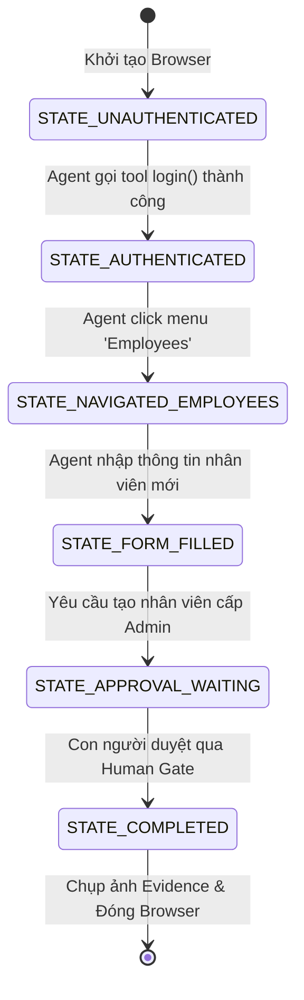
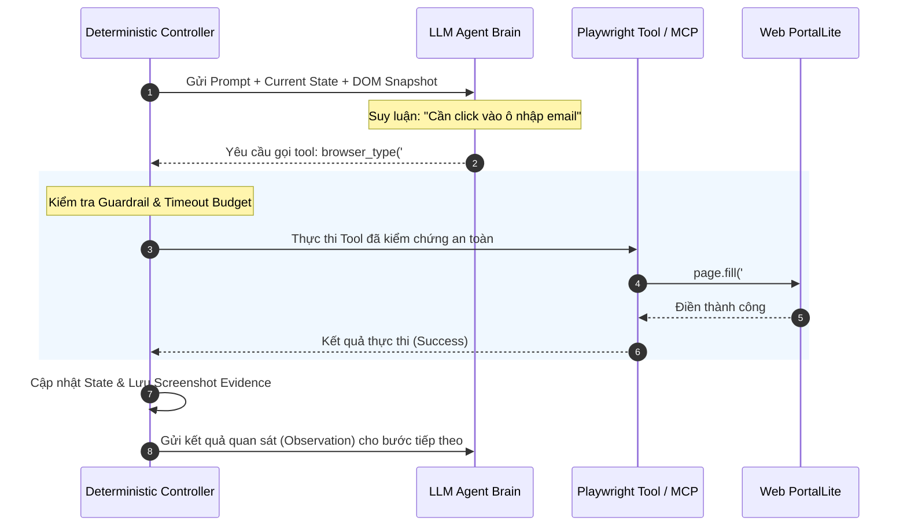
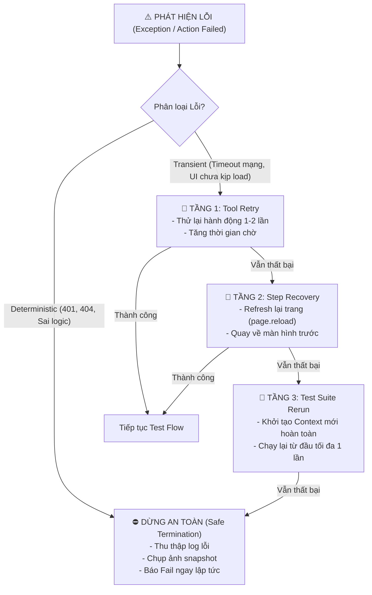

# 📘 CHỦ ĐỀ 06: KIẾN TRÚC TÁC TỬ AI & THỰC THI KIỂM THỬ TRỰC TIẾP (AAALE)

> **Mã môn tương ứng trong Calendar:** `[L3_AIQE_AALE]` / `[L3_AIQE_AAALE]` (AI Agent Architecture & Live Execution)  
> **Mục tiêu:** Giúp Fresher AIQE hiểu sâu cấu trúc giải phẫu của một AI Testing Agent, cơ chế kết hợp giữa bộ điều khiển tất định (Deterministic Controller) và trí tuệ suy luận của LLM, chiến lược xử lý lỗi & retry 3 tầng, kiểm soát rủi ro bằng rào chắn (Guardrails) và cổng phê duyệt của con người (Human Approval Gates).

---

## 📖 1. Từ điển Thuật ngữ Cốt lõi trong AAALE

| Thuật ngữ | Tên tiếng Việt | Bản chất & Giải thích kỹ thuật cho Fresher | Ví dụ minh họa |
| :--- | :--- | :--- | :--- |
| **AI Agent (Testing Agent)** | Tác tử AI kiểm thử | Một hệ thống phần mềm sử dụng LLM làm "bộ não" suy luận, kết hợp với bộ nhớ (Memory/State) và tập công cụ (Tools) để tự động thực hiện các mục tiêu kiểm thử phức tạp một cách tự hành. | Agent tự đọc test scenario ➔ mở trình duyệt ➔ tìm nút bấm ➔ nhập dữ liệu ➔ assert kết quả ➔ chụp ảnh bằng chứng. |
| **Anatomy of an Agent** | Cấu trúc giải phẫu của Agent | 5 thành phần sống còn cấu thành một Agent: **1) Goal** (Mục tiêu); **2) Memory & State** (Bộ nhớ trạng thái); **3) Tools** (Công cụ được cấp phép); **4) Run Controller** (Bộ điều phối); **5) Guardrails** (Rào chắn an toàn). | Thiếu bất kỳ thành phần nào, Agent sẽ mất phương hướng hoặc gây nguy hiểm cho hệ thống. |
| **ReAct Loop (Reason + Act)** | Vòng lặp Suy luận & Hành động | Chu trình hoạt động cốt lõi của Agent: **Quan sát (Observation)** môi trường ➔ **Suy luận (Thought/Reasoning)** bước đi tiếp theo ➔ Chọn và gọi **Hành động (Action/Tool)** ➔ Lại quan sát kết quả trả về. | Vòng lặp: Thấy form đăng nhập ➔ Suy luận cần nhập pass ➔ Gọi tool `type(password)` ➔ Thấy xuất hiện dashboard. |
| **Deterministic Controller** | Bộ điều khiển tất định | Lớp mã nguồn bao bọc bên ngoài LLM để ép Agent tuân thủ đúng thứ tự các bước máy trạng thái (State Machine), ngăn chặn việc LLM tự ý nhảy cóc qua bước kiểm thử. | Không cho phép Agent gọi tool `delete_employee` khi chưa vượt qua bước `verify_login_success`. |
| **Least Privilege** | Nguyên tắc đặc quyền tối thiểu | Chỉ cấp cho Agent đúng những công cụ (Tools) và quyền hạn tối thiểu cần thiết để hoàn thành bài test, không trao quyền dư thừa. | Agent test tính năng xem báo cáo thì tuyệt đối không cấp Tool có quyền xóa Database hoặc gọi lệnh Shell hệ thống. |
| **Guardrails / Circuit Breaker** | Rào chắn / Cầu dao an toàn | Các điều kiện chặn đứng Agent ngay lập tức khi phát hiện hành vi bất thường, lặp vô tận (Infinite loop) hoặc nguy hiểm. | Cầu dao ngắt: Nếu Agent gọi tool thất bại liên tiếp 5 lần hoặc chạy quá 10 phút, tự động dừng khẩn cấp và báo lỗi cho con người. |
| **Transient vs Deterministic Error** | Lỗi tạm thời vs Lỗi cố định | **Transient Error:** Lỗi chập chờn do mạng giật, lag 1-2 giây rồi hết (có thể retry). **Deterministic Error:** Lỗi code sai, sai mật khẩu, sai URL (càng retry càng fail ➔ dừng ngay). | Mạng timeout 504 ➔ Transient Error; Mã lỗi 401 Unauthorized ➔ Deterministic Error. |
| **3-Tier Retry Strategy** | Chiến lược thử lại 3 tầng | Cơ chế phục hồi lỗi phân cấp: **Tầng 1:** Retry ngay tại Tool Call; **Tầng 2:** Phục hồi tại Step (quay lại trang trước); **Tầng 3:** Rerun toàn bộ bài test từ đầu trong môi trường sạch. | Nút chưa kịp click ➔ retry click lại 1 lần (Tầng 1); Nếu trang bị trắng ➔ reload trang (Tầng 2). |
| **Human Approval Gate** | Cổng phê duyệt của con người | Điểm dừng bắt buộc trong workflow mà tại đó Agent phải tạm dừng, hiển thị thông tin và chờ con người bấm nút "Đồng ý" mới được đi tiếp. | Trước khi thực hiện lệnh xóa 100 nhân viên thử nghiệm trên môi trường Staging, Agent phải dừng chờ QA bấm Confirm. |
| **Side Effects** | Tác dụng phụ / Thay đổi trạng thái | Những thay đổi mà hành động của Agent để lại trên cơ sở dữ liệu hoặc hệ thống bên ngoài (Tạo đơn hàng thật, gửi email thật, trừ tiền trong ví). | Cần có cơ chế Cleanup hoặc rollback sau khi Agent chạy xong để tránh làm bẩn database. |

---

## 🏛️ 2. Sơ đồ Kiến trúc Giải phẫu của một AI Testing Agent

```
┌────────────────────────────────────────────────────────────────────────┐
│                        RUN CONTROLLER (Deterministic)                  │
│                                                                        │
│   ┌────────────────────────────────────────────────────────────────┐   │
│   │                        LLM REASONING CORE                      │   │
│   │  - System Prompt (Vai trò, Luật lệ, Định dạng)                 │   │
│   │  - ReAct Loop (Thought ➔ Action ➔ Observation)                 │   │
│   └────────────────────────────────┬───────────────────────────────┘   │
│                                    │                                   │
│        ┌───────────────────────────┼───────────────────────────┐       │
│        ▼                           ▼                           ▼       │
│   ┌─────────────┐            ┌─────────────┐            ┌────────────┐ │
│   │ AGENT STATE │            │    TOOLS    │            │ GUARDRAILS │ │
│   │ - History   │            │ - Navigate  │            │ - Max Steps│ │
│   │ - Context   │            │ - Click     │            │ - Timeout  │ │
│   │ - Variables │            │ - Type      │            │ - Safe Stop│ │
│   │ - Evidence  │            │ - Assert    │            │ - HITL Gate│ │
│   └─────────────┘            └─────────────┘            └────────────┘ │
│                                    │                                   │
└────────────────────────────────────┼───────────────────────────────────┘
                                     ▼
                        [ HỆ THỐNG KIỂM THỬ (SUT) ]
                    (Trình duyệt Web / Rest API / Database)
```

---

## ⚙️ 3. Các Quy trình Thực thi Chuẩn theo Mô hình Input - Process - Output

---

### 📌 Workflow 1: Phân rã Test Case Thủ công thành Workflow Máy trạng thái (State Machine)

Trước khi giao việc cho Agent, Fresher phải phân rã kịch bản E2E thành các trạng thái rõ ràng để tránh việc Agent bị "lạc lối":



#### 1. Dữ liệu Đầu vào (Input):
- Kịch bản kiểm thử E2E: *"Tạo một nhân viên mới và cấp quyền Quản trị viên trong PortalLite"*.
- Danh mục công cụ được phép dùng: `[browser_navigate, browser_click, browser_type, browser_snapshot]`.

#### 2. Quy trình Xử lý (Process / Workflow):
1. Thiết lập biến trạng thái hiện tại (`currentState = STATE_UNAUTHENTICATED`).
2. Ràng buộc Gate: Ở trạng thái nào chỉ được phép thực hiện hành động tương ứng của trạng thái đó.
3. Nếu Agent cố gọi tool tạo nhân viên khi chưa ở trạng thái `STATE_NAVIGATED_EMPLOYEES`, Controller sẽ từ chối và nhắc nhở Agent.

#### 3. Sản phẩm Đầu ra (Output):
File cấu hình Contract State Transition rõ ràng, định nghĩa tiền điều kiện (Precondition) và hậu điều kiện (Postcondition) của từng bước.

---

### 📌 Workflow 2: Vòng lặp Thực thi Trực tiếp (Live ReAct Loop with Guardrails)



---

### 📌 Workflow 3: Chiến lược Xử lý Lỗi 3 Tầng & Safe Termination

Khi một bước kiểm thử của Agent bị lỗi, hệ thống kích hoạt chu trình phục hồi phân tầng:



#### Tiêu chí Dừng An Toàn (Safe Termination Contract):
Khi Agent phải dừng do lỗi, Agent bắt buộc phải thực thi đủ 3 việc trước khi tắt process:
1. **Dọn dẹp tài nguyên (Cleanup):** Hủy các token rác, đóng các context trình duyệt đang mở để tránh rò rỉ bộ nhớ (Memory Leak).
2. **Thu thập bằng chứng thất bại (Evidence Bundle):** Tự động lưu `failure-screenshot.png`, `dom-snapshot.html` và file dòng thời gian `execution-timeline.json`.
3. **Báo cáo trung thực:** Ghi rõ lỗi tại Step nào, vì sao dừng, và những dữ liệu nào chưa kịp hoàn tác để QA vào xử lý thủ công.

---

## ⚠️ 4. Các Lỗi Phổ biến Fresher hay Mắc phải (Common Pitfalls)

1. **Thả rông Agent chạy hoàn toàn tự do (Unbounded Agent):**  
   Không cài đặt `max_steps` (số bước tối đa) hay `timeout_budget`, khiến Agent khi gặp bug bị lặp vòng vô tận, ngốn hàng triệu token và làm nghẽn server.
2. **Không phân biệt lỗi Transient và Deterministic:**  
   Khi nhập sai mật khẩu (Deterministic), Agent vẫn cố gắng retry 10 lần liên tiếp dẫn đến việc tài khoản thử nghiệm bị hệ thống khóa cứng vĩnh viễn.
3. **Bỏ qua bước dọn dẹp tác dụng phụ (Side Effect Cleanup):**  
   Mỗi lần test Agent lại tự ý tạo ra 1 user mới trong Database mà không xóa đi, sau 1 tuần Database ngập rác và gây xung đột trùng lặp email.

---

## 🎯 5. Checklist Ôn tập & Câu hỏi Tự kiểm tra

- [ ] Trình bày 5 thành phần cốt lõi trong **Anatomy của một AI Testing Agent**.
- [ ] Tại sao không nên để LLM điều khiển 100% luồng chạy mà bắt buộc phải có **Deterministic Controller** bao bọc bên ngoài?
- [ ] Phân biệt **Transient Error** và **Deterministic Error**. Khi nào thì được phép Retry?
- [ ] Trình bày chiến lược phục hồi lỗi **3-Tier Retry** trong kiểm thử tự hành.
- [ ] **Human Approval Gate** là gì? Hãy đưa ra 2 ví dụ về trường hợp bắt buộc phải cài đặt cổng này trong dự án thực tế.

