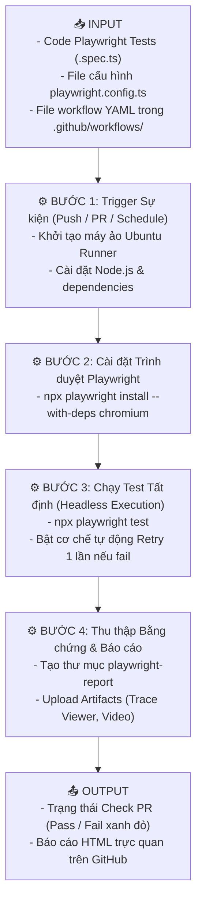
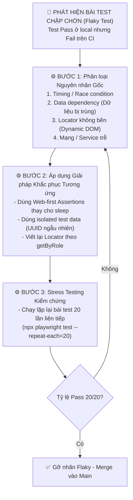

# 📘 CHỦ ĐỀ 07: TỐI ƯU HÓA AGENT, QUẢN TRỊ RỦI RO & TÍCH HỢP CI/CD (AOCE)

> **Mã môn tương ứng trong Calendar:** `[L3_AIQE_AOCE]` (Agent Optimization & CI Execution)  
> **Mục tiêu:** Giúp Fresher AIQE làm chủ kỹ năng đo lường chi phí & hiệu năng của Agent (Token usage & Benchmarking), kiểm soát hiện tượng trôi dạt chỉ dẫn (Prompt Drift), tích hợp kịch bản kiểm thử vào luồng tự động hóa CI/CD (GitHub Actions), phân loại và xử lý triệt để bài test không ổn định (Flaky Tests), đồng thời thiết lập Bảng quản trị rủi ro (Risk Register) và các chỉ số đo lường chất lượng (Quality Metrics).

---

## 📖 1. Từ điển Thuật ngữ Cốt lõi trong AOCE

| Thuật ngữ | Tên tiếng Việt | Bản chất & Giải thích kỹ thuật | Ví dụ thực tế |
| :--- | :--- | :--- | :--- |
| **Deterministic Execution vs Probabilistic Generation** | Thực thi tất định vs Sinh mã xác suất | **Nguyên tắc vàng của AIQE:** Dùng AI (xác suất) để hỗ trợ thiết kế hoặc sinh test case ở giai đoạn offline (Preparation phase), nhưng khi chạy test tự động trên CI/CD server thì bắt buộc phải chạy bằng mã script Playwright cố định (Deterministic phase). | Không để LLM suy luận trực tiếp trên server CI lúc nửa đêm; chỉ chạy file test `.spec.ts` đã được compile. |
| **CI/CD Pipeline** | Đường ống Tích hợp & Chuyển giao liên tục | Hệ thống tự động kích hoạt build, kiểm thử và đóng gói phần mềm ngay khi có lập trình viên đẩy code mới lên GitHub/GitLab. | Lập trình viên tạo Pull Request (PR) ➔ GitHub Actions tự động bật máy ảo chạy 500 bài test Playwright trong 3 phút. |
| **Headless Mode** | Chế độ chạy không giao diện | Chế độ mà trình duyệt (Chromium/Firefox) chạy ngầm hoàn toàn trong RAM và CPU của máy chủ Linux/Docker mà không cần màn hình hiển thị đồ họa. | Giúp tiết kiệm 70% RAM và tăng tốc độ chạy test lên gấp nhiều lần trên máy chủ CI. |
| **Flaky Test** | Bài test chập chờn / không ổn định | Bài test lúc Pass lúc Fail dù mã nguồn không đổi. Đây là "kẻ thù số 1" của Automation QA vì nó làm mất niềm tin của toàn đội ngũ vào hệ thống kiểm thử tự động. | Chạy 10 lần thì 8 lần Pass, 2 lần Fail do mạng lag làm API phản hồi trễ 100ms. |
| **Heuristic Recovery** | Phục hồi theo kinh nghiệm phỏng đoán | Các chiến lược xử lý thông minh được lập trình sẵn để cứu vãn bài test khi gặp tình huống bất ngờ trên UI mà không làm bài test chết đứng. | Nếu click bị chặn bởi một banner quảng cáo pop-up bất ngờ xuất hiện ➔ tự động bấm nút đóng popup rồi mới click lại. |
| **Prompt Drift** | Trôi dạt lời nhắc | Hiện tượng chất lượng đầu ra của AI Agent suy giảm hoặc thay đổi hành vi theo thời gian khi nhà cung cấp LLM cập nhật phiên bản model mới ở phía backend. | Cần có bộ test benchmark định kỳ để phát hiện sự thay đổi độ chính xác của Prompt. |
| **Token Budget & Cost** | Ngân sách Token & Chi phí | Giới hạn số lượng Token (Input + Output) tối đa mà Agent được phép tiêu thụ cho một phiên chạy nhằm kiểm soát chi phí tài chính. | Đặt ngưỡng tối đa 20.000 tokens cho 1 ca kiểm thử; nếu vượt quá thì Agent phải dừng. |
| **Defect Escape Rate (Defect Leakage)** | Tỷ lệ lỗi lọt lưới | Tỷ lệ phần trăm lỗi lọt qua các tầng kiểm thử của QA và bị người dùng cuối phát hiện trên môi trường Production. | $\text{Defect Escape Rate} = \frac{\text{Số lỗi tìm thấy trên Prod}}{\text{Tổng số lỗi (QA + Prod)}} \times 100\%$. Càng thấp chứng tỏ chất lượng QA càng cao. |
| **Risk Register** | Sổ đăng ký rủi ro | Bảng quản lý tập trung các rủi ro kỹ thuật và vận hành có thể đe dọa đến chất lượng sản phẩm, bao gồm xác suất xảy ra, mức độ ảnh hưởng và kế hoạch giảm thiểu (Mitigation plan). | Rủi ro: *"Cổng thanh toán bên thứ ba hay sập vào khung giờ cao điểm 12h trưa"* ➔ Biện pháp: Thêm Circuit Breaker và mock fallback. |

---

## 🏗️ 2. Nguyên tắc Tách Pha: Chuẩn hóa Quy trình CI/CD cho AIQE

Để đảm bảo hệ thống CI/CD chạy nhanh, ổn định và chi phí tối thiểu, Fresher cần ghi nhớ mô hình tách pha:

```
┌────────────────────────────────────────────────────────────────────────┐
│   PHA 1: AGENT PREPARATION (Chạy có AI, Không chạy trên CI hàng ngày)  │
│   - Nhận User Story / Requirement                                      │
│   - Dùng AI Agent phân tích, sinh BDD, sinh mã test Playwright         │
│   - Tester Review mã nguồn, chạy thử nghiệm local                      │
│   - Commit mã nguồn .spec.ts vào Git Repository                        │
└───────────────────────────────────┬────────────────────────────────────┘
                                    │ Commit & Pull Request
                                    ▼
┌────────────────────────────────────────────────────────────────────────┐
│   PHA 2: DETERMINISTIC EXECUTION (Chạy trên GitHub Actions CI/CD)      │
│   - Kích hoạt tự động khi có PR hoặc chạy theo lịch hẹn ban đêm (Cron) │
│   - Chạy 100% bằng Playwright CLI (Headless mode)                      │
│   - Hoàn toàn KHÔNG phụ thuộc vào API LLM bên ngoài (Tránh lag/chi phí)│
│   - Xuất HTML Test Report và upload Artifacts khi có lỗi               │
└────────────────────────────────────────────────────────────────────────┘
```

---

## ⚙️ 3. Các Quy trình Thực thi Chuẩn theo Mô hình Input - Process - Output

---

### 📌 Workflow 1: Tích hợp Pipeline Kiểm thử Tự động với GitHub Actions Workflow (Unit 5)



#### File Cấu hình Workflow Mẫu (`.github/workflows/e2e-tests.yml`):
```yaml
name: PortalLite E2E Regression Suite

on:
  push:
    branches: [ main, develop ]
  pull_request:
    branches: [ main ]
  schedule:
    # Chạy tự động lúc 01:00 AM UTC mỗi ngày
    - cron: '0 1 * * *'

jobs:
  test:
    timeout-minutes: 30
    runs-on: ubuntu-latest

    steps:
      - name: 1. Checkout source code
        uses: actions/checkout@v4

      - name: 2. Thiết lập Node.js v20
        uses: actions/setup-node@v4
        with:
          node-version: 20
          cache: 'npm'

      - name: 3. Cài đặt thư viện dependencies
        run: npm ci

      - name: 4. Cài đặt Playwright Browsers (Chỉ Chromium để tối ưu thời gian)
        run: npx playwright install --with-deps chromium

      - name: 5. Chạy Playwright Tests (Headless mode)
        run: npx playwright test --project=chromium
        env:
          CI: true

      - name: 6. Upload Báo cáo kiểm thử làm Artifact
        if: always() # Luôn chạy bước này kể cả khi test fail
        uses: actions/upload-artifact@v4
        with:
          name: playwright-test-results
          path: playwright-report/
          retention-days: 14
```

---

### 📌 Workflow 2: Quy trình Phân loại & Khắc phục Flaky Tests trên CI (Unit 6)



---

### 📌 Workflow 3: Xây dựng Bảng Quản trị Rủi ro (Risk Register) & Đo lường Metrics (Unit 7)

#### Bảng Quản trị Rủi ro Mẫu (Risk Register):
| Rủi ro (Risk Item) | Xác suất (P) | Mức ảnh hưởng (I) | Điểm rủi ro ($P \times I$) | Kế hoạch Giảm thiểu (Mitigation Strategy) | Người phụ trách |
| :--- | :---: | :---: | :---: | :--- | :--- |
| **R1: Server CI bị timeout do mạng nội bộ lag** | Trung bình (3) | Cao (4) | **12 (Cao)** | Cấu hình `retries: 1` trong `playwright.config.ts`, tăng action timeout từ 10s lên 15s. | QA Lead |
| **R2: Token chi phí LLM tăng vọt do Agent lặp vô tận** | Thấp (2) | Rất cao (5) | **10 (Trung bình)** | Cài đặt Guardrail `max_steps: 15` và giới hạn ngân sách hàng tháng cho API Key. | AIQE Engineer |
| **R3: Test data bị xung đột khi nhiều người chạy test song song** | Cao (4) | Cao (4) | **16 (Nghiêm trọng)** | Gắn UUID động vào email và username (`user_test_${Date.now()}@mock.internal`). | Automation QA |

#### Các Chỉ số Kiểm thử Cốt lõi (Core QA Metrics):
1. **Test Pass Rate:** Tỷ lệ bài test đạt trên tổng số bài test chạy ($\ge 95\%$ là tiêu chuẩn chấp nhận).
2. **Defect Escape Rate:** Tỷ lệ bug lọt lên Production ($\le 5\%$ là mức mục tiêu của các dự án chất lượng cao).
3. **Execution Duration:** Tổng thời gian hoàn thành toàn bộ bộ test trên CI (mục tiêu $< 15$ phút để phản hồi nhanh cho lập trình viên).

---

## ⚠️ 4. Các Lỗi Phổ biến Fresher hay Mắc phải (Common Pitfalls)

1. **Lạm dụng cơ chế Retry trên CI (`retries: 5`):**  
   Cố tình tăng số lần retry thật cao để "ép" test pass qua mắt CI mà không chịu sửa nguyên nhân gây flaky test. Điều này chỉ làm che giấu bug và tốn thời gian chạy máy chủ CI.
2. **Hardcode thông tin bí mật (API Keys / Passwords) vào file YAML:**  
   Cam kết các token bí mật lên Git repository công khai. Bắt buộc phải dùng **GitHub Secrets** (`${{ secrets.MY_API_KEY }}`).
3. **Không thu thập Artifacts khi kiểm thử thất bại:**  
   Khi test fail trên máy ảo CI, nếu không cấu hình upload thư mục `playwright-report` hoặc `trace.zip`, tester sẽ hoàn toàn không có cách nào điều tra được lỗi vì máy ảo bị xóa ngay sau khi chạy xong.

---

## 🎯 5. Checklist Ôn tập & Câu hỏi Tự kiểm tra

- [ ] Giải thích nguyên tắc **Tách pha** (Tách pha Agent Preparation khỏi Pha Deterministic Execution) khi đưa test lên CI/CD.
- [ ] Sự khác biệt giữa chạy test ở chế độ **Headless** và **Headed** là gì? Tại sao trên CI luôn dùng Headless?
- [ ] Kể tên 3 nguyên nhân phổ biến nhất gây ra hiện tượng **Flaky Test** và biện pháp xử lý tương ứng.
- [ ] Làm thế nào để chạy kiểm chứng độ ổn định của một bài test bằng lệnh `repeat-each` trong Playwright?
- [ ] Công thức tính **Defect Escape Rate** là gì? Ý nghĩa của chỉ số này đối với đội ngũ QA?

