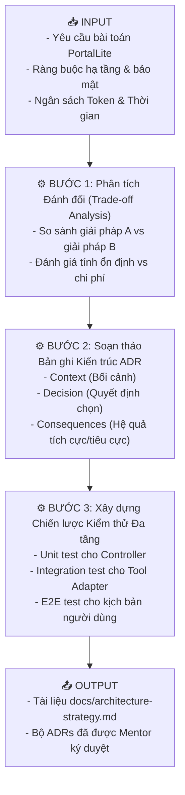
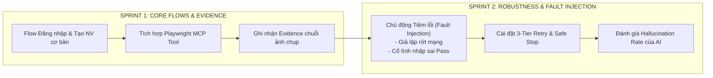
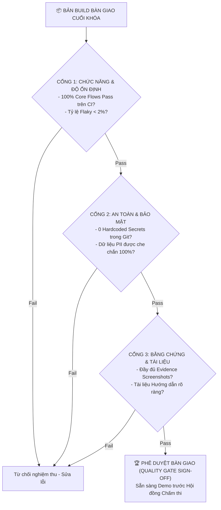

# 📘 CHỦ ĐỀ 08: PHÁT TRIỂN DỰ ÁN AI AGENT THỰC CHIẾN & KỸ NĂNG BÀN GIAO (PBAAD & PSFR)

> **Mã môn tương ứng trong Calendar:** `[L4_AIQE_PBAAD]` & `[L4_AIQE_PSFR]`  
> **Mục tiêu:** Giúp Fresher AIQE làm chủ quy trình phát triển một giải pháp Tác tử AI kiểm thử (AI Test Agent) hoàn chỉnh từ khâu tiếp nhận yêu cầu (Kickoff Charter), thiết kế kiến trúc phân định ranh giới tin cậy (Trust Boundary & ADR), triển khai theo phương pháp Agile qua 2 Sprint (Core Flows & Robustness/Fault Injection), vượt qua Cổng chất lượng nghiêm ngặt (Quality Gate Audit) và thuyết trình Demo chuyên nghiệp trước khách hàng.

---

## 📖 1. Từ điển Thuật ngữ Cốt lõi trong Dự án Thực chiến (PBAAD)

| Thuật ngữ | Tên tiếng Việt | Bản chất & Giải thích kỹ thuật cho Fresher | Ví dụ trong Dự án Capstone |
| :--- | :--- | :--- | :--- |
| **Project Charter** | Bản điều lệ dự án | Văn bản tuyên ngôn chính thức xác lập mục tiêu, phạm vi (Scope in/out), giả định, rủi ro ban đầu và vai trò trách nhiệm của các thành viên trong dự án. | Xác định rõ mục tiêu: Xây dựng `PortalLite QA Assistant` để tự động hóa 100% luồng đăng nhập và tạo nhân viên. |
| **Trust Boundary** | Ranh giới tin cậy | Vạch phân cách an ninh giữa các vùng có mức độ tin cậy khác nhau (Ví dụ: Vùng Prompt của người dùng không tin cậy vs Vùng thực thi Controller của hệ thống). | Agent không được phép lấy dữ liệu thô chưa qua lọc từ Web để chạy trực tiếp lệnh Database. |
| **ADR (Architectural Decision Record)** | Bản ghi quyết định kiến trúc | Tài liệu kỹ thuật ghi lại một quyết định thiết kế quan trọng, bối cảnh ra quyết định, các phương án thay thế đã cân nhắc và lý do lựa chọn phương án cuối cùng. | `ADR-001: Lựa chọn Playwright MCP thay vì Selenium WebDriver do khả năng Auto-waiting và hỗ trợ Snapshot AI`. |
| **Vertical Slice** | Lát cắt dọc hoàn chỉnh | Cách tiếp cận phát triển mà trong đó nhóm hoàn thiện một tính năng xuyên suốt từ giao diện (UI) ➔ Logic xử lý ➔ Lưu vết dữ liệu ➔ Báo cáo thay vì làm xong toàn bộ UI mới làm đến logic. | Sprint 1 hoàn thiện trọn vẹn 1 flow duy nhất: *Đăng nhập ➔ Chụp màn hình ➔ Ghi log*, nhưng luồng này chạy mượt mà 100%. |
| **Fault Injection** | Kỹ thuật tiêm lỗi có kiểm soát | Chủ động cố tình đưa các sự cố vào môi trường kiểm thử (Rớt mạng giả lập, Mock mã lỗi 500 từ API, Trả về dữ liệu trống) để kiểm tra xem AI Agent có khả năng tự phục hồi hoặc dừng an toàn hay không. | Cố tình ngắt mạng 3 giây trong khi Agent đang tải trang xem Agent có kích hoạt cơ chế Retry hay bị crash. |
| **Quality Gate** | Cổng chất lượng | Tập hợp các tiêu chuẩn kỹ thuật bắt buộc phải vượt qua trước khi một phần mềm hoặc kịch bản kiểm thử được phép đưa lên môi trường tiếp theo. | Tiêu chí: Zero critical bug, 100% Pass rate trên CI, Không rò rỉ mã bí mật (Secret leak check pass). |
| **Demo Narrative** | Kịch bản dẫn dắt Demo | Câu chuyện có cấu trúc và logic chặt chẽ khi trình bày sản phẩm trước khách hàng/stakeholder, đi từ *Vấn đề thực tế ➔ Cách giải pháp giải quyết ➔ Trình diễn Live ➔ Bằng chứng nghiệm thu*. | Tránh chỉ bật code lên giải thích; phải bắt đầu bằng nỗi đau của người dùng và lợi ích kinh doanh mang lại. |
| **Sprint Retrospective** | Họp cải tiến sau Sprint | Phiên họp nội bộ định kỳ cuối mỗi Sprint để nhìn nhận: *Điều gì làm tốt (Went well)? Điều gì chưa tốt (Needs improvement)? Hành động cải tiến trong Sprint tới (Action items)?* | Phát hiện lý do Sprint 1 trễ tiến độ là do prompt viết chưa rõ ràng ➔ Sprint 2 áp dụng mẫu prompt 5 thành phần. |

---

## 🏛️ 2. Bản đồ Kiến trúc Giải pháp Tổng thể (PortalLite QA Assistant Architecture)

Trong bài toán tốt nghiệp Capstone Project, giải pháp AIQE Agent được xây dựng theo mô hình phân tầng nghiêm ngặt:

```
                  ┌──────────────────────────────────────────────┐
                  │          NGƯỜI DÙNG / TEST LEADER            │
                  │   - Cung cấp Kịch bản Test (.feature / MD)   │
                  │   - Phê duyệt qua Human Approval Gate        │
                  └───────────────────────┬──────────────────────┘
                                          │
                                          ▼
┌────────────────────────────────────────────────────────────────────────────────────────┐
│ [VÙNG TIN CẬY CAO] DETERMINISTIC RUN CONTROLLER                                        │
│                                                                                        │
│   ┌──────────────────────────┐        ┌────────────────────────────────────────────┐   │
│   │   AGENT STATE MACHINE    │        │          GUARDRAILS & AUDIT LOG            │   │
│   │   - Trạng thái hiện tại  │◄──────►│  - Giới hạn Max Steps (15 bước)            │   │
│   │   - Biến môi trường      │        │  - Budget Timeout (120s)                   │   │
│   │   - Lịch sử bước chạy    │        │  - Circuit Breaker (Cắt khi lặp vô tận)    │   │
│   └─────────────┬────────────┘        └────────────────────────────────────────────┘   │
│                 │                                                                      │
│                 ▼                                                                      │
│   ┌──────────────────────────┐        ┌────────────────────────────────────────────┐   │
│   │    LLM REASONING CORE    │        │           EVIDENCE PACKAGER                │   │
│   │  - System Prompt Chuẩn   │───────►│  - Thu thập Traces, Screenshots            │   │
│   │  - Bóc tách Intent       │        │  - Xuất execution-report.md                │   │
│   └─────────────┬────────────┘        └────────────────────────────────────────────┘   │
│                 │                                                                      │
└─────────────────┼──────────────────────────────────────────────────────────────────────┘
                  │ [RANH GIỚI TIN CẬY - TRUST BOUNDARY]
                  ▼ (Gọi qua Tool Contract JSON Schema)
┌────────────────────────────────────────────────────────────────────────────────────────┐
│ [VÙNG THỰC THI NGOÀI] EXECUTION ADAPTERS (Playwright MCP)                             │
│   ├── browser_navigate(url)                                                            │
│   ├── browser_click(selector)                                                          │
│   ├── browser_fill(selector, text)                                                     │
│   └── browser_snapshot()                                                               │
└─────────────────────────────────┬──────────────────────────────────────────────────────┘
                                  ▼
                [ HỆ THỐNG MỤC TIÊU: PORTALLITE APPLICATION ]
```

---

## ⚙️ 3. Quy trình Triển khai Dự án theo Mô hình Input - Process - Output

---

### 📌 Workflow 1: Thiết lập Quyết định Kiến trúc (ADR) & Test Strategy (Unit 2)



#### Mẫu Quyết định Kiến trúc Thực tế (`docs/adr/ADR-002-state-machine.md`):
* **Title:** ADR-002: Sử dụng Máy trạng thái hữu hạn (FSM) cho Run Controller.
* **Status:** Accepted (Đã phê duyệt).
* **Context:** Nếu để LLM tự quyết định bước đi tiếp theo hoàn toàn tự do, Agent có xác suất 15% bị nhảy cóc qua bước kiểm tra form hoặc cố gắng click nút Submit nhiều lần liên tiếp khi mạng chậm.
* **Decision:** Nhóm quyết định cài đặt một Máy trạng thái hữu hạn (Finite State Machine - FSM) bằng TypeScript bọc bên ngoài. LLM chỉ được phép đề xuất hành động hợp lệ với trạng thái hiện tại (`CURRENT_STATE`).
* **Consequences:**
  * *Tích cực:* Loại bỏ hoàn toàn lỗi lặp hành động ngoài ý muốn; kịch bản test ổn định 100%.
  * *Tiêu cực:* Tốn thêm công sức lập trình các bộ chuyển trạng thái (State Transition Handlers) ban đầu.

---

### 📌 Workflow 2: Triển khai 2 Sprints: Core Flow ➔ Robustness & Fault Injection (Unit 3 & 4)



#### Bảng Kịch bản Tiêm Lỗi Kiểm chứng Độ Bền vững (Fault Injection Test Matrix):
| Mã Thử nghiệm | Sự cố Cố tình Gây ra (Injected Fault) | Hành vi Sai nếu Agent Kém | Hành vi Chuẩn của Agent Xuất sắc | Đánh giá |
| :--- | :--- | :--- | :--- | :---: |
| **FI-01** | Cắt kết nối mạng 5s lúc đang submit form | Agent crash, văng lỗi unhandled exception ra màn hình console | Agent bắt lỗi `NetworkError`, kích hoạt Tầng 1 Retry, giữ nguyên dữ liệu form và submit lại khi mạng phục hồi | ✅ ĐẠT |
| **FI-02** | Form hiển thị Popup cảnh báo bất ngờ đè lên nút Save | Agent cố click vào nút Save và timeout 30s do bị che khuất | Agent phát hiện bị che, kích hoạt Heuristic Handler đóng popup rồi mới click nút Save | ✅ ĐẠT |
| **FI-03** | Tài khoản thử nghiệm bị hết hạn phiên (Session Expired) | Agent tiếp tục điền form một cách vô nghĩa | Agent phát hiện URL bị redirect về `/login`, dừng bài test an toàn và báo lỗi `SESSION_EXPIRED` | ✅ ĐẠT |

---

### 📌 Workflow 3: Thẩm định Cổng Chất lượng (Quality Gate Audit) & Bàn giao Dự án (Unit 5 & 6)



#### Cấu trúc Bài Thuyết trình Demo Chuẩn (Demo Narrative Structure):
1. **Mở đầu (2 phút):** Nêu bài toán thực tế và thách thức kiểm thử của dự án `PortalLite` (Các luồng phân quyền phức tạp, rủi ro lỗi người dùng).
2. **Kiến trúc & Ranh giới an toàn (3 phút):** Trình bày sơ đồ Trust Boundary và lý do chọn kiến trúc Deterministic Controller kết hợp LLM.
3. **Trình diễn Trực tiếp (Live Demo - 7 phút):**
   * *Màn 1:* Cho Agent chạy tự động hoàn thành luồng Happy Path (Tạo nhân viên thành công, tự động chụp ảnh bằng chứng).
   * *Màn 2:* Trình diễn màn Tiêm lỗi (Fault Injection) để chứng minh Agent không bị crash và tự phục hồi thông minh.
   * *Màn 3:* Thể hiện cổng phê duyệt Human Approval Gate khi gặp tác vụ nhạy cảm.
4. **Báo cáo Chỉ số & Tổng kết (3 phút):** Trình chiếu Dashboard Token Cost, Pass Rate trên CI và trả lời câu hỏi của Giám khảo/Khách hàng.

---

## ⚠️ 4. Các Lỗi Phổ biến Fresher hay Mắc phải (Common Pitfalls)

1. **"Ôm đồm" phạm vi (Scope Creep):** Cố gắng xây dựng một Agent biết làm tất cả mọi thứ nhưng tính năng nào cũng chập chờn, thay vì hoàn thiện xuất sắc 2 flow trọng tâm.
2. **Demo theo kiểu "Show Code":** Dành toàn bộ thời gian trình chiếu từng dòng code TypeScript cho khách hàng xem.  
   👉 *Nguyên tắc:* Khách hàng và Stakeholder quan tâm đến **Giá trị nghiệp vụ, Độ ổn định và Bằng chứng kiểm thử**, không phải chi tiết cú pháp code.
3. **Bỏ qua buổi Retrospective:** Kết thúc sprint mà không họp rút kinh nghiệm, lặp lại cùng một sai lầm về quản lý dữ liệu test ở sprint tiếp theo.

---

## 🎯 5. Checklist Ôn tập & Câu hỏi Tự kiểm tra

- [ ] Bản điều lệ dự án (**Project Charter**) khác gì so với tài liệu yêu cầu phần mềm (**PRD**)?
- [ ] Tại sao việc thiết lập **Trust Boundary** lại là yêu cầu bắt buộc khi xây dựng AI Agent cho doanh nghiệp?
- [ ] **Fault Injection** là gì? Hãy nêu cách bạn thiết kế một ca kiểm thử tiêm lỗi mạng cho Agent.
- [ ] Kể tên 4 tiêu chí cốt lõi trong một **Quality Gate Review** trước khi phát hành giải pháp kiểm thử.
- [ ] Trình bày cấu trúc 4 bước của một bài **Customer Demo Narrative** thuyết phục.

