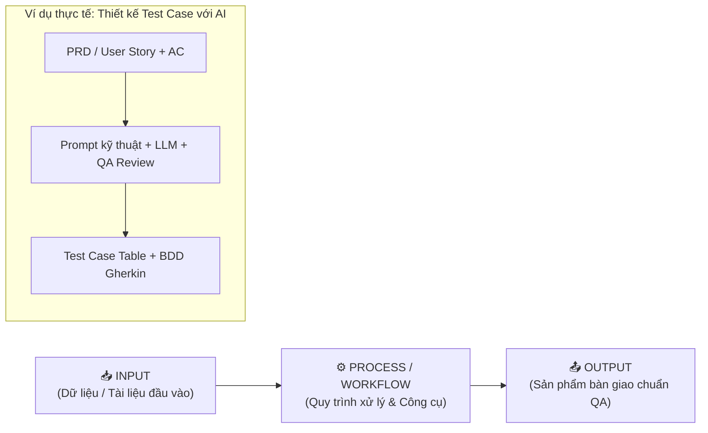

# 📘 BỘ TÀI LIỆU ÔN TẬP TOÀN DIỆN CHO FRESHER AIQE (AI QUALITY ENGINEER)

> **Dành cho:** Fresher AIQE, Automation Test Engineer, Manual QA chuyển dịch sang kiểm thử có hỗ trợ của AI (AI-Assisted Testing) & Tự động hoá với AI Agent.  
> **Phương pháp tiếp cận:** Học theo mô hình **Input ➔ Process / Workflow ➔ Output**, giải thích chi tiết thuật ngữ kiểm thử (Testing Terminology) và ví dụ thực chiến từ hệ thống thực tế.

---

## 🧭 1. Giới thiệu Chương trình Đào tạo AIQE

Chương trình **AI Quality Engineer (AIQE)** được thiết kế nhằm nâng cấp toàn diện kỹ năng của một kỹ sư kiểm thử phần mềm từ nền tảng cổ điển đến năng lực ứng dụng Trí tuệ nhân tạo (AI/LLM) và Tác tử AI (AI Agents) vào toàn bộ chu trình kiểm thử (STLC - Software Testing Life Cycle).

### 🎯 Mục tiêu chuyển đổi năng lực (Role Transition)
```
┌─────────────────────────┐       ┌──────────────────────────┐       ┌─────────────────────────┐
│   Manual QA Tester      │  ───► │  Automation QA Tester    │  ───► │   AI Quality Engineer   │
│ - Đọc specs thủ công     │       │ - Viết code Playwright   │       │ - Dùng AI thiết kế test │
│ - Viết test case Excel  │       │ - Chạy test tự động      │       │ - Tối ưu hóa với Prompt │
│ - Bắt bug bằng mắt      │       │ - CI/CD cơ bản           │       │ - Xây dựng AI Test Agent│
│ - Báo cáo lỗi thủ công  │       │ - Page Object Model      │       │ - Phân tích Log/RCA tự động│
└─────────────────────────┘       └──────────────────────────┘       └─────────────────────────┘
```

---

## 🗂️ 2. Danh mục các Chủ đề Ôn tập (Curriculum Modules)

Bộ tài liệu được chia thành **9 chuyên đề chuyên sâu**, tương ứng với lộ trình đào tạo chuẩn của Fresher AIQE:

| Mã File | Tên Chủ đề Ôn tập | Trọng tâm Kiến thức |
| :--- | :--- | :--- |
| **[01_AIQE_QA_Foundations_Manual_Testing.md](./01_AIQE_QA_Foundations_Manual_Testing.md)** | **Chủ đề 1: Nền tảng QA & Kiểm thử Phần mềm Thủ công** | 7 nguyên lý kiểm thử, Test Levels, Test Types, Phân vùng tương đương (EP), Giá trị biên (BVA), Bảng quyết định, Defect Life Cycle. |
| **[02_AIQE_Prompt_Engineering_For_Testing.md](./02_AIQE_Prompt_Engineering_For_Testing.md)** | **Chủ đề 2: Nền tảng GenAI & Kỹ thuật Prompting trong QA** | Bản chất LLM, Kỹ thuật Prompting (Zero-shot, Few-shot, CoT), Hallucination Control, Masking dữ liệu nhạy cảm (PII), Human-in-the-Loop. |
| **[03_AIQE_ARTD_AI_Assisted_Requirement_Test_Design.md](./03_AIQE_ARTD_AI_Assisted_Requirement_Test_Design.md)** | **Chủ đề 3: Phân tích Yêu cầu & Thiết kế Kiểm thử với AI (ARTD)** | Phát hiện mơ hồ (Ambiguity detection), Sinh kịch bản BDD Gherkin, Ma trận bao phủ (Coverage Matrix), RTM, Sinh dữ liệu kiểm thử (Test Data). |
| **[04_AIQE_PMLM_Playwright_MCP_Locator_Mastery.md](./04_AIQE_PMLM_Playwright_MCP_Locator_Mastery.md)** | **Chủ đề 4: Tự động hoá với Playwright & Kỹ thuật Locator / MCP (PMLM)** | Kiến trúc Playwright, Auto-waiting, Chiến lược Locator chuẩn Accessibility (`getByRole`, `getByLabel`), Model Context Protocol (MCP), POM. |
| **[05_AIQE_DALA_AI_Assisted_Defect_API_Log_Analysis.md](./05_AIQE_DALA_AI_Assisted_Defect_API_Log_Analysis.md)** | **Chủ đề 5: Phân tích Lỗi, API & Log có hỗ trợ AI (DALA)** | Báo cáo lỗi sẵn sàng Triage, Phân tích Root Cause Analysis (RCA) từ Log, Phân tích Correlation ID, Kiểm thử REST API âm tính & biên hợp đồng. |
| **[06_AIQE_AAALE_AI_Agent_Architecture_Live_Execution.md](./06_AIQE_AAALE_AI_Agent_Architecture_Live_Execution.md)** | **Chủ đề 6: Kiến trúc Tác tử AI & Thực thi Kiểm thử Trực tiếp (AAALE)** | Anatomy của AI Test Agent (Goal, Tool, State, Guardrail), Vòng lặp ReAct, Xử lý lỗi & Retry 3 lớp, Thu thập bằng chứng, Human Approval Gate. |
| **[07_AIQE_AOCE_Agent_Optimization_CI_Execution.md](./07_AIQE_AOCE_Agent_Optimization_CI_Execution.md)** | **Chủ đề 7: Tối ưu hoá Agent, CI Execution & Xử lý Flaky (AOCE)** | Benchmark Token & Cost, Prompt Drift, Chạy Headless trên GitHub Actions CI, Triage Flaky Tests, Heuristic Recovery, Risk Register & Metrics. |
| **[08_AIQE_PBAAD_Project_Based_AI_Agent_Development.md](./08_AIQE_PBAAD_Project_Based_AI_Agent_Development.md)** | **Chủ đề 8: Phát triển Dự án AI Agent Thực chiến (PBAAD & Capstone)** | Quy trình dự án PortalLite QA Assistant, Kiến trúc Trust Boundary, Sprint 1 (Core Flows) & Sprint 2 (Fault Injection), Quality Gate, Demo. |
| **[09_AIQE_Glossary_And_Interview_CheatSheet.md](./09_AIQE_Glossary_And_Interview_CheatSheet.md)** | **Chủ đề 9: Bảng Tra cứu Thuật ngữ & Bộ Câu hỏi Phỏng vấn AIQE** | Bảng tra cứu thuật ngữ A-Z chuẩn ISTQB & AI Testing, 30+ câu hỏi phỏng vấn và thi tuyển AIQE sát hạch kèm câu trả lời mẫu. |

---

## 💡 3. Hướng dẫn Phương pháp Học theo Mô hình Input - Process - Output

Để trở thành một AIQE xuất sắc, bạn không học vẹt lý thuyết mà cần nắm chắc tư duy vận hành theo mô hình:



Mỗi tài liệu trong bộ này đều được cấu trúc thống nhất:
1. **Thuật ngữ chuyên ngành cốt lõi (Terminology):** Giải thích rõ bản chất, so sánh các cặp thuật ngữ hay nhầm lẫn (ví dụ: *Verification vs Validation*, *Severity vs Priority*, *Probabilistic vs Deterministic*).
2. **Mô hình Workflow chuẩn (Input ➔ Process ➔ Output):** Có bảng phân rã chi tiết dữ liệu đầu vào cần gì, quy trình từng bước xử lý ra sao, và tiêu chí nghiệm thu của sản phẩm đầu ra.
3. **Mã nguồn / Prompt mẫu & Minh họa từ Case Study thực tế:** Sử dụng xuyên suốt các bài toán trong giáo trình (`PortalLite`, `Order Management System API`, `SauceDemo`).
4. **Cảnh báo lỗi thường gặp (Common Pitfalls):** Những cạm bẫy mà Fresher rất dễ mắc phải (như tin tuyệt đối vào AI gây Hallucination, dùng XPath tuyệt đối dễ gãy, chạy flaky test trên CI).
5. **Checklist kiểm tra kiến thức & Câu hỏi ôn luyện:** Giúp bạn tự kiểm tra trước các bài Quiz và Module Exam.

---
*Chúc bạn ôn tập hiệu quả và tự tin chinh phục các kỳ thi sát hạch Fresher AIQE!*

