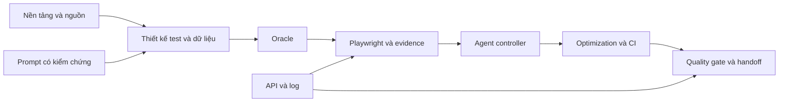

# AIQE Review — Ôn tập cho fresher AI Quality Engineer

Bắt đầu với [nền tảng QA](01_topics/qa-foundations.md), rồi học theo thứ tự dưới đây. Bộ tài liệu diễn giải nguồn trong workspace để ôn kiến thức, luyện phỏng vấn và tự kiểm tra; câu hỏi **tự biên soạn, không phải đề thi chính thức**. Không có cam kết nội dung nào chắc chắn xuất hiện trong đề thi.

## Phạm vi thực tế

TrainingCalendar có 10 module. Workspace có giáo trình chi tiết cho ARTD, DALA, PMLM, AAALE, AOCE và PBAAD; thiếu giáo trình riêng FPR, MTPTD, FPE, PSFR. Hai bài nền tảng và bài readiness là cầu nối được ghi nhãn, chưa thay thế bốn giáo trình thiếu. Bộ ôn không phải xác nhận hoàn thành toàn khóa hay project đã chạy live.

Cách tổ chức: mỗi chủ đề có một bài giảng chính, liên kết sang glossary/phỏng vấn/quiz; kiến thức giao nhau được nối bằng đường dẫn. ARTD/DALA dùng ví dụ order/payment/refund; PMLM/AAALE/AOCE/PBAAD dùng PortalLite employee/QA run. Không trộn contract hoặc flow ID giữa các baseline.

## Thứ tự ôn

| Bước | Bài kiến thức | Phỏng vấn | Tự làm quiz |
|---|---|---|---|
| 1 | [Nền tảng QA](01_topics/qa-foundations.md) | [5 câu](03_interview/qa-foundations.md) | [8 câu](04_quiz/qa-foundations.md) |
| 2 | [Prompt và AI review](01_topics/prompt-engineering.md) | [5 câu](03_interview/prompt-engineering.md) | [8 câu](04_quiz/prompt-engineering.md) |
| 3 | [Yêu cầu và thiết kế test](01_topics/requirement-test-design.md) | [5 câu](03_interview/requirement-test-design.md) | [8 câu](04_quiz/requirement-test-design.md) |
| 4 | [Dữ liệu và privacy](01_topics/test-data-privacy.md) | [5 câu](03_interview/test-data-privacy.md) | [8 câu](04_quiz/test-data-privacy.md) |
| 5 | [Defect, API và log](01_topics/defect-api-log-analysis.md) | [5 câu](03_interview/defect-api-log-analysis.md) | [8 câu](04_quiz/defect-api-log-analysis.md) |
| 6 | [Playwright locator](01_topics/playwright-locators.md) | [6 câu](03_interview/playwright-locators.md) | [10 câu](04_quiz/playwright-locators-questions.md) |
| 7 | [Execution và debugging](01_topics/playwright-execution-debugging.md) | [6 câu](03_interview/playwright-execution-debugging.md) | [10 câu](04_quiz/playwright-execution-debugging-questions.md) |
| 8 | [Agent architecture](01_topics/agent-architecture.md) | [6 câu](03_interview/agent-architecture.md) | [10 câu](04_quiz/agent-architecture-questions.md) |
| 9 | [Optimization và metrics](01_topics/optimization-metrics.md) | [Phỏng vấn](03_interview/optimization-metrics.md) | [Quiz](04_quiz/optimization-metrics.md) |
| 10 | [CI và recovery](01_topics/ci-recovery.md) | [Phỏng vấn](03_interview/ci-recovery.md) | [Quiz](04_quiz/ci-recovery.md) |
| 11 | [Project quality gates](01_topics/project-quality-gates.md) | [Phỏng vấn](03_interview/project-quality-gates.md) | [Quiz](04_quiz/project-quality-gates.md) |

Trong mỗi lượt học: đọc mục tiêu/tiên quyết → tự giải thích ví dụ không nhìn tài liệu → làm quiz trước khi mở file `*-answers.md` → nói thử một câu phỏng vấn → sửa một artifact nhỏ. Với câu sai, giải thích cả vì sao ba phương án nhiễu sai, rồi quay lại bài chính.

## Thực hành

- [Diagnostic, kế hoạch test và giao tiếp](05_practice/readiness-and-communication.md): bắt đầu không cần môi trường chạy.
- [Requirement → dữ liệu → API/log](05_practice/design-api-data-lab.md): luyện thiết kế và điều tra trên source pack.
- [Playwright + agent workflow](05_practice/playwright-agent-lab.md): thiết kế trước, live chỉ khi có runtime và quyền thích hợp.
- [Project evidence lab](05_practice/project-evidence-lab.md): metrics, sự cố, gate và bàn giao có giới hạn bằng chứng.

Ví dụ code trong tài liệu là minh họa hoặc pseudocode nếu được ghi nhãn. Không mặc định endpoint/selector/grant trong packet đúng với ứng dụng của bạn. Không chép dữ liệu người thật hay secret vào prompt hoặc artifact.

## Tra cứu và kiểm soát độ đầy đủ

- [Glossary Anh–Việt](02_keywords/glossary.md) · [Các cặp dễ nhầm](02_keywords/easily_confused.md).
- [Danh sách 88 nguồn và trạng thái đọc](00_tracking/source_inventory.md).
- [Ma trận module/mục tiêu/unit/keyword](00_tracking/coverage_matrix.md).
- [Khoảng trống và mâu thuẫn](00_tracking/gaps_and_conflicts.md).
- [Tiến độ và cách tiếp tục](00_tracking/progress.md).
- [Nguồn web đã mở đọc](06_sources/web_sources.md).

**Bắt buộc nắm** là mức ưu tiên ôn tập do người biên soạn chọn theo course, không phải xác nhận đề thi. **Nên hiểu** giúp giải thích và thực hành. **Mở rộng** là phần cần học sâu hơn khi gặp bài toán tương ứng. Đoạn **Bổ sung từ nguồn web** có nguồn riêng; ví dụ tự biên không được trình bày thành kết quả chạy.
